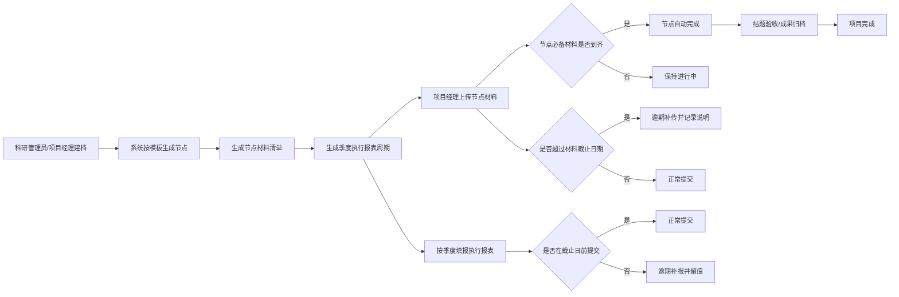
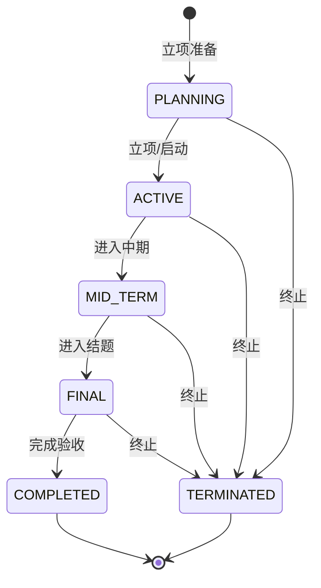

# 科研项目材料管理系统

# 需求规格说明书

| 项目   | 内容                                              |
| ---- | ----------------------------------------------- |
| 系统名称 | 科研项目材料管理系统（Research Material Management System） |
| 文档版本 | V1.0                                            |
| 编制日期 | 2026-11-05                                      |
| 适用范围 | 国企内部科研项目材料归集、节点跟踪、季度报表、经费台账与展示                  |
| 交付形态 | 前后端分离源码 + MySQL 脚本 + 部署脚本 + 文档                  |
| 审批边界 | **不包含立项、中期、结题等审批流**，仅记录与提醒                      |

## 1. 背景与目标

### 1.1 业务背景

国企科研项目管理通常同时受到集团科技管理办法、部门科研实施细则、财务经费管理制度约束。项目类型多、周期长、参与部门多，实际执行中常见以下问题：

1. 项目立项、开题、中期、结题、归档等节点要求提交的材料分散在个人电脑和聊天工具中，缺少统一台账。
2. 项目经理不清楚“什么时间该交什么材料”，科研管理人员也难以快速判断材料是否如期提交。
3. 季度执行报表依赖人工催报，漏报、迟报无法直观发现。
4. 项目经费投入与支出由不同人员掌握，展示时口径不一致。
5. 部门门口或走廊缺少一块能实时反映项目数量、完成情况和经费投入的展示界面。
6. 项目结束较长时间后，补充材料仍可能到达，系统需要允许补传并保留逾期痕迹。

### 1.2 建设目标

建设一套轻量、可部署、可二次开发的 B/S 系统：

- 以“项目—流程节点—节点材料—附件”为主线，形成科研项目材料全周期台账。
- 以“季度报表—截止日期—填报状态”为主线，解决季度执行报表漏报问题。
- 以“经费台账—项目汇总—部门统计”为主线，统一经费投入口径。
- 以“逾期提醒—补传补报—留痕”为主线，确保材料即使晚交也能归集。
- 以“管理驾驶舱 + 门口展示大屏”为主线，让部门科研情况可被直观看到。
- 不引入审批环节，避免把记录系统做成流程审批系统，降低上线阻力。

### 1.3 设计参照

在交互与权限设计上参考了国内成熟后台管理系统（如 RuoYi、JeecgBoot 等）的通用做法：左侧菜单、RBAC 角色、统一响应结构、分页查询、操作日志、字典化状态。代码为独立实现，不直接复制任何开源项目代码。

## 2. 建设范围

### 2.1 本期范围

| 编号  | 范围     | 说明                                    |
| --- | ------ | ------------------------------------- |
| S1  | 组织与账号  | 部门、用户、四类角色、登录、改密                      |
| S2  | 项目建档   | 项目基础信息、经理、部门、周期、经费总额、状态、进度            |
| S3  | 流程模板   | 节点模板、节点材料模板，可配置比例、偏移天数、截止锚点           |
| S4  | 项目流程实例 | 创建项目时快照生成节点、材料、季度报表                   |
| S5  | 材料归集   | 上传、追加、下载、预览、删除、逾期补传、补传说明、无需提交         |
| S6  | 季度报表   | 按季度生成、草稿、提交、逾期补报、撤回、附件                |
| S7  | 经费台账   | 支出登记、编辑、删除、累计汇总、执行率                   |
| S8  | 提醒     | 逾期材料、逾期报表、未来 30 天到期、统一提醒中心            |
| S9  | 看板与大屏  | 内部工作台、部门统计、项目卡片、门口展示大屏                |
| S10 | 系统管理   | 用户、部门、模板、操作日志                         |
| S11 | 交付物    | 源码、SQL、脚本、部署文件、需求/技术/数据库/部署/使用/API 文档 |

### 2.2 不在本期范围

- 立项、开题、中期、结题、验收的审批流转与电子签章。
- 专家评审、打分、会议管理。
- 财务凭证、发票查验、预算科目控制、会计凭证对接。
- 企业微信/钉钉/邮件消息推送（保留扩展点，不默认实现）。
- 移动端 App、小程序。
- 与集团统一身份认证、主数据、档案系统的正式接口（文档说明扩展方式）。
- OCR 自动识别、材料智能查重、知识图谱。

## 3. 术语与角色

### 3.1 术语

| 术语     | 定义                                   |
| ------ | ------------------------------------ |
| 项目     | 一个科研项目主记录，具有编号、名称、周期、经理、部门、经费等属性     |
| 流程节点   | 项目生命周期中的阶段，如项目启动、开题论证、中期检查、结题验收、成果归档 |
| 节点材料   | 某节点下要求提交的材料，如开题报告、经费决算表              |
| 材料实例   | 项目创建时由模板快照生成的具体材料，具有独立截止日期和状态        |
| 截止锚点   | 计算材料截止日期所依附的日期，如节点结束日期、项目结束日期        |
| 季度执行报表 | 按自然季度填报的项目执行情况，季度结束后第 15 天截止         |
| 经费台账   | 项目经费支出明细，累计金额回写项目已支出                 |
| 展示大屏   | 面向办公室门口屏幕的只读可视化页面，通过访问码开放            |
| 逾期补传   | 材料超过截止日期后仍允许上传，系统标记为“逾期提交”并记录补传说明    |

### 3.2 角色与权限

| 角色编码               | 角色名称  | 核心职责                      | 权限边界                   |
| ------------------ | ----- | ------------------------- | ---------------------- |
| `ADMIN`            | 系统管理员 | 系统配置、账号、部门、模板、全部项目        | 全部功能；可重置密码、查看日志        |
| `RESEARCH_MANAGER` | 科研管理员 | 科研归口管理、项目建档、催报、模板维护、全部项目  | 全部项目读写、模板维护、日志查看；不管理账号 |
| `PROJECT_MANAGER`  | 项目经理  | 维护本人负责项目、上传材料、填报季度报表、登记经费 | 仅本人负责项目可写；其他项目不可见      |
| `VIEWER`           | 查看/展示 | 只读查看项目、材料、报表、统计           | 不可写；用于领导查看或展示账号        |

权限矩阵：

| 功能          | ADMIN | RESEARCH_MANAGER | PROJECT_MANAGER | VIEWER |
| ----------- | ----- | ---------------- | --------------- | ------ |
| 查看全部项目      | ✓     | ✓                | 仅本人             | ✓      |
| 新建/编辑/删除项目  | ✓     | ✓                | 仅本人项目（不可转交）     | —      |
| 维护流程模板      | ✓     | ✓                | —               | —      |
| 上传/追加材料     | ✓     | ✓                | 仅本人项目           | —      |
| 标记无需提交/重置材料 | ✓     | ✓                | —               | —      |
| 填报季度报表      | ✓     | ✓                | 仅本人项目           | —      |
| 撤回已提交报表     | ✓     | ✓                | —               | —      |
| 登记经费        | ✓     | ✓                | 仅本人项目           | —      |
| 管理用户/部门     | ✓     | —                | —               | —      |
| 查看操作日志      | ✓     | ✓                | —               | —      |
| 查看提醒        | ✓     | ✓                | 仅本人项目           | ✓      |
| 查看展示大屏      | 访问码   | 访问码              | 访问码             | 访问码    |

## 4. 业务流程

### 4.1 项目全周期主流程



### 4.2 新建项目动作链

1. 校验项目名称、部门、项目经理、起止日期、经费等必填项。
2. 项目编号为空时自动生成 `KY-{年份}-{三位序号}`。
3. 保存项目主记录。
4. 读取启用中的流程节点模板，按“项目周期比例 + 偏移天数”计算节点计划起止日期。
5. 读取每个节点的材料模板，按“截止锚点 + 偏移天数”计算材料截止日期。
6. 生成季度报表行：从项目开始季度到结束季度，每季度一行，截止日期为季度末 + 15 天。
7. 记录操作日志。

### 4.3 与现有信息系统的关系

公司现有系统继续承担其原有职责，本系统定位为“科研项目材料与节点台账”，不重复建设审批流：

| 现有系统   | 原有职责                         | 本系统承接                              |
| ------ | ---------------------------- | ---------------------------------- |
| 数智采购系统 | 项目如需采购，先发起采购申请并走流程           | 记录采购申请及 ERP 流程材料是否归集，不复制审批         |
| ERP    | 项目基本信息、立项编号、计划起止时间、项目经理、采购流程 | 回填 `ERP立项编号`、`ERP采购申请编号`，作为项目主数据关联 |
| 采购询比系统 | 调研公告、三家响应、调研评审、询价公告、三家报价、最低价 | 记录询比各环节材料是否齐备，回填询比系统编号             |
| 本系统    | 科研项目材料台账、节点跟踪、季度执行、逾期提醒、展示大屏 | 统一查看“项目—节点—材料”是否如期归集，不替代外部系统       |

### 4.4 流程节点与材料路径

默认模板依据公司现行科研项目管理流程设置，可在“流程模板”页面调整。修改模板只影响新项目，已生成项目保持快照，避免历史数据被追溯改写。

| 顺序  | 节点   | 周期位置          | 默认材料                                                                                  | 制度对应                      |
| --- | ---- | ------------- | ------------------------------------------------------------------------------------- | ------------------------- |
| 1   | 立项准备 | 0%—10%        | 科研建议书、可行性研究报告、立项报告、总办会评审会议纪要                                                          | 附件1、附件2、附件3、附件4           |
| 2   | 执行过程 | 10%—90%       | 采购申请及 ERP 流程材料、调研公告、三家单位响应文件、调研评审报表、询价公告、三家单位报价文件、最低价确认及 ERP 录入材料；项目变更情况表；检测报告；知识产权证明 | 附件5.2-1—5.2-7、5.3、5.4、5.5 |
| 3   | 验收管理 | 90%—100%      | 验收申请表、项目总结报告、项目技术总结报告、项目财务决算报告                                                        | 附件6、附件7、附件8、附件9           |
| 4   | 成果归档 | 100%，结束 +30 天 | 科研档案移交清单、成果归档登记表                                                                      | 档案管理要求                    |

材料分类：

| 分类编码          | 名称   | 典型材料         | 是否进入提醒        |
| ------------- | ---- | ------------ | ------------- |
| `INITIATION`  | 立项材料 | 附件1—4        | 是（必备）         |
| `PROCUREMENT` | 采购材料 | 5.2-1—5.2-7  | 否（选交，按实际采购归集） |
| `CHANGE`      | 变更材料 | 5.3          | 否（发生变更时归集）    |
| `TESTING`     | 检测报告 | 5.4          | 否（按实际检测归集）    |
| `IP`          | 知识产权 | 5.5          | 否（按实际成果归集）    |
| `ACCEPTANCE`  | 验收材料 | 附件6—9        | 是（必备）         |
| `ARCHIVE`     | 归档材料 | 档案移交清单、成果登记表 | 是（必备）         |

> 季度执行情况表（附件5.1）不放入节点材料，作为独立的周期性报表管理，避免与节点材料重复计数。

### 4.5 菜单结构

系统按“项目全周期 + 业务材料分类”组织菜单：

| 一级菜单 | 二级菜单 | 业务内容                         |
| ---- | ---- | ---------------------------- |
| 运行总览 | —    | 项目数量、完成率、经费、逾期、部门统计、知识产权数量统计 |
| 项目台账 | —    | 项目主数据、ERP/采购/询比编号、材料总览、经费    |
| 立项管理 | —    | 附件1—4 归集、ERP 立项编号回填          |
| 过程执行 | 季度执行 | 附件5.1 季度执行情况表                |
| 过程执行 | 采购管理 | 数智采购/询比/ERP 采购材料链            |
| 过程执行 | 变更管理 | 附件5.3 项目变更情况表                |
| 过程执行 | 检测报告 | 附件5.4 检测报告                   |
| 过程执行 | 知识产权 | 附件5.5 软著/专利/论文               |
| 验收管理 | —    | 附件6—9 验收材料                   |
| 逾期提醒 | —    | 逾期材料、逾期报表、30 天内到期            |
| 流程模板 | —    | 节点模板、材料模板、业务分类               |
| 系统管理 | —    | 用户、部门、操作日志                   |
| 展示大屏 | —    | 门口大屏（独立路由）                   |

### 4.6 状态机

**项目状态**



项目状态由管理员/科研管理员手工维护，系统不自动审批，也不强制状态流转。

**节点状态**

- `NOT_STARTED`：当前日期早于节点计划开始日期，且必备材料未到齐。
- `IN_PROGRESS`：已到计划开始日期，或已过计划结束日期但材料未到齐。
- `COMPLETED`：该节点全部必备材料已提交/逾期提交/标记无需提交。

**材料状态**

| 状态          | 触发条件           | 是否计入已完成  |
| ----------- | -------------- | -------- |
| `PENDING`   | 初始状态，未上传附件     | 否        |
| `SUBMITTED` | 在截止日期当天或之前首次上传 | 是        |
| `LATE`      | 超过截止日期后首次上传    | 是（但标记逾期） |
| `WAIVED`    | 科研管理员标记“无需提交”  | 是        |

**季度报表展示状态**

- `PENDING`：未提交，且未过截止日期。
- `OVERDUE`：未提交，且已过截止日期（数据库存储仍为 `PENDING`，由查询计算）。
- `SUBMITTED`：已提交且未逾期。
- `LATE`：已提交但提交日期晚于截止日期（由查询计算）。

## 5. 功能需求

### FR-01 登录与账号安全

- 用户使用账号密码登录，返回签名 Token，前端在 `Authorization: Bearer` 中携带。
- Token 默认 12 小时过期，可在配置中调整。
- 密码使用 PBKDF2-HMAC-SHA256（120,000 次迭代、随机盐）存储，禁止明文。
- 支持本人修改密码；管理员可重置密码。
- 支持账号启用/停用；停用后立即无法登录。
- 登录失败返回统一提示“账号或密码错误”，不泄露账号是否存在。

**验收标准**

1. 正确账号密码可进入系统，错误密码返回 401。
2. 数据库密码字段无明文。
3. 停用账号无法登录。
4. Token 过期或伪造时返回 401，前端跳转登录页。

### FR-02 项目建档与维护

- 支持项目编号、名称、类别、级别、来源、部门、经理、参与人、起止日期、经费总额、经费来源、状态、进度、简介。
- 支持回填 ERP 立项编号、ERP 采购申请编号、采购询比系统编号，作为与现有系统的关联字段。
- 项目编号可留空自动生成，且全局唯一。
- 结束日期不得早于开始日期；经费总额不得小于已支出。
- 项目经理只能维护本人项目，且不能把项目转交他人；科研管理员/系统管理员可维护全部项目。
- 删除为逻辑删除，历史报表、附件、日志保留在数据库中。
- 修改项目起止日期时，系统重算未提交材料的截止日期与节点计划日期，并补充新增季度的报表行。

**验收标准**

1. 新建项目后自动生成 4 个节点、10 项必备材料、10 项选交材料、季度报表。
2. 项目编号重复时提示冲突。
3. 项目经理访问他人项目返回 403。
4. 修改结束日期后，未提交材料截止日期随之变化，已提交材料不被改写。
5. ERP/采购/询比编号可以在项目表单中维护，并在项目台账、分类页、详情页展示。

### FR-03 流程模板管理

- 支持节点模板增改、停用；节点编码唯一。
- 节点字段：编码、名称、顺序、开始/结束比例（0—1）、开始/结束偏移天数、说明、启用状态。
- 支持材料模板增改、停用；材料编码唯一。
- 材料字段：编码、名称、所属节点、业务分类、是否必备、截止锚点、偏移天数、是否允许逾期补传、说明、排序、启用状态。
- 业务分类支持立项、采购、变更、检测、知识产权、验收、归档和其他，用于分类台账页面。
- 已生成项目不回写模板变更。
- 删除采用停用，避免破坏历史引用。

**验收标准**

1. 新增节点后，新建项目会包含该节点。
2. 停用节点后，新建项目不再生成该节点。
3. 修改材料名称后，已有项目材料名称不变。

### FR-04 节点与材料跟踪

- 项目详情以横向节点卡展示节点计划起止、完成材料数/必备材料数、节点状态。
- 材料列表展示节点、材料名、必备/选交、截止日期、状态、附件数、提交时间、提交人、补传说明。
- 逾期未交材料显示“已逾期 + 逾期天数”。
- 材料上传支持 PDF、Office、图片、压缩包、文本等，单文件默认不超过 50MB。
- 同一材料支持多个附件；追加附件不改变首次提交时间。
- 删除最后一个附件后，材料恢复为待提交。
- 逾期材料允许补传；若模板配置不允许逾期补传，则后端拒绝。
- 科研管理员可将材料标记“无需提交”，必须填写原因；也可重置为待提交。
- 节点在全部必备材料完成后自动变为“已完成”，无需人工审批。

**验收标准**

1. 上传附件后，材料状态变为已提交/逾期提交，节点材料计数增加。
2. 在截止日当天上传视为按时；次日后上传视为逾期。
3. 补传时填写说明会出现在材料记录和操作日志中。
4. 附件下载文件名、类型、大小正确，路径穿越被拒绝。

### FR-05 季度执行报表

- 按项目周期自动生成季度报表行，每个项目每个自然季度唯一。
- 提供“过程执行—季度执行”全局台账，可跨项目按年度、季度、状态筛选并进入填报。
- 截止日期为季度末 + 15 天（可通过环境变量调整）。
- 支持填写：本期执行情况、阶段成果、存在问题、下期计划、本期支出、累计支出。
- 支持保存草稿和提交；提交必须有本期执行情况。
- 逾期仍可提交，列表显示“逾期提交”。
- 科研管理员/系统管理员可撤回已提交报表，项目经理不可撤回。
- 支持报表附件上传、下载、删除。
- 支持“同步周期”，补充因项目延期而新增的季度行。

**验收标准**

1. 新建 2026-01-01 至 2026-12-31 的项目，生成 2026 Q1—Q4 共 4 行。
2. 2026 Q1 截止日期为 2026-04-15。
3. 未提交且过期显示“已逾期”；提交晚于截止日显示“逾期提交”。
4. 普通项目经理无法撤回已提交报表。

### FR-06 经费台账

- 项目详情展示批复经费、累计支出、预算余额、执行率。
- 项目经理可登记经费支出：日期、金额、经费类型、支出科目、说明。
- 金额必须大于 0，发生日期不得晚于今天。
- 新增、修改、删除支出后，自动按明细汇总项目累计支出。
- 经费执行率 = 累计支出 / 批复经费 × 100%，批复经费为 0 时显示 0。
- 支持按项目查看明细；部门/全部门统计在看板聚合。

**验收标准**

1. 登记 10 万、20 万两笔支出，项目累计支出为 30 万。
2. 删除一笔后累计支出同步减少。
3. 批复经费小于累计支出时，项目编辑被拒绝并提示。

### FR-07 逾期与到期提醒

- 实时计算，不依赖定时任务。
- 逾期材料：必备、状态为待提交、截止日期早于今天。
- 逾期报表：状态为未提交、截止日期早于今天。
- 即将到期：未来 30 天内到期的待提交材料/报表。
- 提醒中心支持类型筛选、状态筛选、分页。
- 提供汇总数：逾期材料数、逾期报表数、即将到期数、逾期总数。
- 可从提醒直接进入项目详情并打开补传/补报对话框。
- 项目经理只能看到本人项目提醒；科研管理员/系统管理员/查看角色看到全部。

**验收标准**

1. 逾期材料数随上传/删除附件实时变化。
2. 提醒列表中的“逾期天数”与截止日期一致。
3. 点击“去补传”可打开对应材料上传窗口。

### FR-08 管理驾驶舱

- 项目总数、在研数、已完成数、完成率。
- 批复经费总额、累计支出、经费执行率。
- 材料按时率、已到期材料数、按时提交数。
- 季度报表填报率、逾期报表数。
- 项目状态分布、类别分布、部门项目与经费统计。
- 重点项目进度列表、待办提醒列表。
- 项目经理登录时，统计范围限定为本人项目。

**验收标准**

1. 关键指标与项目明细汇总一致。
2. 项目经理只能看到本人项目统计。
3. 数据在项目/材料/报表变更后刷新即更新。

### FR-09 门口展示大屏

- 独立路由 `/display`，无需登录，使用访问码。
- 访问码通过后端配置 `app.display.access-key` 设置。
- 顶部统计卡展示：项目总数、在研项目、已完成、验收待办、累计研发投入、经费执行率、材料按时率、知识产权归集项目。
- 展示本年度研发投入趋势（月度投入 + 累计投入）。
- 展示材料归集分布（立项/采购/变更/检测/知识产权/验收/归档）。
- 展示项目节点（立项准备→执行过程→验收管理→成果归档）及计划日期。
- 展示项目验收结果表（项目编号、名称、周期、验收材料完成数、验收状态）。
- 展示逾期与待办列表（逾期材料、季度报表）。
- 60 秒自动刷新；显示当前时间。
- 支持全屏、刷新、切换访问码。
- 不提供任何写操作。

**验收标准**

1. 错误访问码返回 403，正确访问码展示数据。
2. 1920×1080 和 1600×1000 下无横向滚动。
3. 大屏接口不要求登录 Token。
4. 顶部统计、投入趋势、材料分布、项目节点、验收结果和逾期待办均能显示真实数据。

### FR-10 系统管理

- 用户管理：查询、新增、编辑、停用、重置密码。
- 部门管理：查询、新增、编辑。
- 操作日志：登录、项目、材料、报表、经费、模板、用户等关键写操作。
- 日志记录操作人、角色、模块、动作、对象、详情、IP、时间。

**验收标准**

1. 新增用户后可用初始密码登录。
2. 停用用户无法登录。
3. 项目经理无用户管理入口，直接访问接口返回 403。

### FR-11 附件与文件管理

- 本地磁盘存储，按年/月分目录，UUID 文件名，保留原始文件名。
- 记录文件大小、MIME、SHA-256、上传人、上传时间。
- 下载需鉴权；支持浏览器预览 PDF/图片/文本。
- 删除为逻辑删除，最后一条材料附件删除后回退材料状态。
- 存储根目录可配置，生产建议独立数据盘或对象存储。

### FR-12 审计与留痕

- 所有关键写操作记录操作日志。
- 材料补传保留补传说明、首次提交时间、提交人。
- 报表提交保留提交人、提交时间；撤回保留日志。
- 项目删除为逻辑删除。

### FR-13 分类材料台账

- 按业务分类提供独立台账页面：立项管理、采购管理、变更管理、检测报告、知识产权、验收管理。
- 每个页面展示项目的外部系统编号、材料完成数、制度材料归集情况、逾期必备材料数。
- 材料节点以状态标签展示：已提交、待提交、逾期、逾期提交、无需提交。
- 点击节点标签可直接进入项目详情对应材料；未提交/逾期材料自动打开上传窗口。
- 支持按项目关键字、部门、项目状态、材料未齐筛选。
- 采购管理页面需体现采购询比链：采购申请/ERP流程、调研公告、三家响应、调研评审、询价公告、三家报价、最低价确认及ERP录入。
- 分类页面仅做材料归集与状态展示，不替代数智采购系统、ERP、采购询比系统的审批与业务操作。

**验收标准**

1. 4 个项目在立项管理页显示 4/4 材料完成，ERP 编号可见。
2. 采购管理页显示每家项目 7 个采购询比材料节点。
3. 点击未提交节点进入项目详情并自动打开上传窗口。
4. 验收管理页能识别逾期验收材料并跳转。
5. 项目经理只能看到本人项目的分类台账。

## 6. 数据与计算规则

### 6.1 节点计划日期

```text
项目周期天数 = 结束日期 - 开始日期（至少 1 天）
节点计划开始 = 项目开始 + round(项目周期天数 × startRatio) + startOffsetDays
节点计划结束 = 项目开始 + round(项目周期天数 × endRatio) + endOffsetDays
若计划结束早于计划开始，则结束 = 开始
```

### 6.2 材料截止日期

```text
锚点 = 项目开始 / 项目结束 / 节点开始 / 节点结束
截止日期 = 锚点日期 + dueOffsetDays
```

默认“成果归档”节点的计划结束为项目结束 + 30 天，因此归档材料截止日期为项目结束后 30 天，满足“项目超过一定期限后仍未补充材料”的跟踪要求。

### 6.3 季度报表截止日期

```text
季度末 = 该季度最后一天
截止日期 = 季度末 + 15 天（可配置）
```

### 6.4 指标口径

| 指标    | 口径                                   |
| ----- | ------------------------------------ |
| 项目完成率 | 已完成项目数 / 未删除项目总数                     |
| 经费执行率 | 项目累计支出合计 / 批复经费合计                    |
| 材料按时率 | 已到期必备材料中“按时提交”的数量 / 已到期必备材料数（不含无需提交） |
| 季度填报率 | 已到期季度报表中已提交数量 / 已到期季度报表数             |
| 逾期总数  | 逾期材料数 + 逾期报表数                        |

## 7. 非功能需求

### 7.1 性能

- 单部门 500 个项目、5 万条材料记录规模下，列表与看板接口 P95 响应时间 ≤ 1.5 秒。
- 文件上传采用流式复制，不将整个文件读入内存。
- 常用查询字段建立索引：项目状态/部门/经理、材料截止日期/状态、报表截止日期/状态。

### 7.2 安全

- 密码 PBKDF2 加盐哈希，禁止明文和可逆加密。
- Token HMAC-SHA256 签名，密钥可配置。
- 所有 `/api/**`（除登录、健康检查、大屏）必须携带 Bearer Token。
- 越权访问返回 403；未登录返回 401。
- 文件路径规范化，阻止路径穿越；文件类型不信任客户端，下载时按存储 MIME 返回。
- 生产环境强制 HTTPS、修改默认密码和展示访问码。
- 操作日志保留 IP 和操作轨迹。

### 7.3 可用性

- 支持 Chrome、Edge 近两年版本；大屏推荐 Chrome 全屏。
- 页面适配 1366×768 及以上；大屏针对 1920×1080 优化。
- 网络短暂中断时前端给出错误提示，不丢失已填写内容（对话框内）。
- 附件目录可备份；数据库支持定期备份。

### 7.4 可维护性

- 前后端分离，接口统一 `/api` 前缀。
- 后端分层：Controller → Service → Repository/JdbcTemplate。
- 状态、角色、日期规则集中定义，便于扩展。
- 配置通过环境变量覆盖，不硬编码数据库密码和密钥。

### 7.5 兼容性

- 数据库 MySQL 8.0+，字符集 utf8mb4。
- JDK 17；Spring Boot 3.2.x。
- Node.js 20+；Vite 6；Vue 3。
- 可运行于 Windows Server、Linux、Docker。

## 8. 验收清单

| 编号  | 验收项  | 通过标准                                        |
| --- | ---- | ------------------------------------------- |
| A1  | 登录   | 四类账号均可登录，错误密码被拒绝                            |
| A2  | 项目创建 | 自动生成节点、材料、季度报表                              |
| A3  | 材料上传 | 正常上传、逾期补传、附件下载均成功                           |
| A4  | 节点完成 | 必备材料全部提交后节点自动完成                             |
| A5  | 季度报表 | 保存草稿、提交、逾期显示、撤回均符合规则                        |
| A6  | 经费   | 新增/删除支出后累计金额与执行率正确                          |
| A7  | 提醒   | 逾期数量与明细一致，可跳转处理                             |
| A8  | 看板   | 指标与明细一致，角色范围正确                              |
| A9  | 大屏   | 访问码校验、自动刷新、全屏展示正常                           |
| A10 | 权限   | 项目经理不能编辑他人项目，查看账号不能写                        |
| A11 | 文档   | 需求、技术、数据库、部署、使用、API 文档齐全                    |
| A12 | 交付   | 源码可在干净环境按文档构建运行                             |
| A13 | 菜单   | 立项/过程执行（季度、采购、变更、检测、知识产权）/验收/提醒/模板/系统管理完整可见 |
| A14 | 制度映射 | 附件1—9 与采购询比材料链均有对应分类或台账页面                   |

## 9. 约束与假设

1. 系统部署在国企内网，默认单租户、单组织；多租户需要额外扩展。
2. 时间统一按 Asia/Shanghai 处理。
3. 项目“完成”由用户维护状态，不由审批结果驱动。
4. 季度报表按自然季度，不按项目自定义财年。
5. 经费单位统一为“万元”，与国企科研项目常用口径一致。
6. 项目删除为逻辑删除，数据库保留关联数据。
7. 大屏访问码适用于内网共享场景，不等同于强身份认证。

## 10. 后续演进建议

1. 接入企业微信/钉钉/邮件，按提醒汇总推送。
2. 接入统一身份认证（LDAP/OAuth2/CAS）。
3. 附件切换 MinIO/OSS，增加病毒扫描与在线 Office 预览。
4. 增加项目导出（Word/Excel/PDF）和材料目录一键打包。
5. 增加多组织、多租户与数据权限。
6. 增加科研办法版本管理，将模板与制度版本关联。
7. 增加移动端拍照上传与消息提醒。
8. 后续可能接进ERP系统，能够拿到项目的信息，包括项目立项时间，项目的成员，以及经费使用情况，变更记录等
