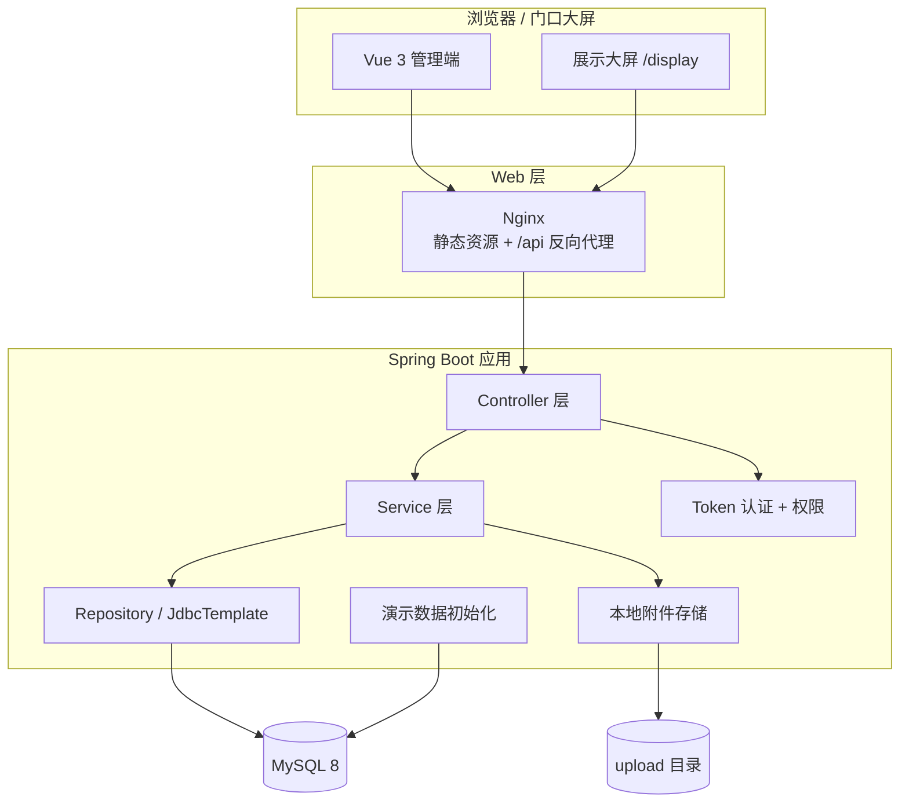
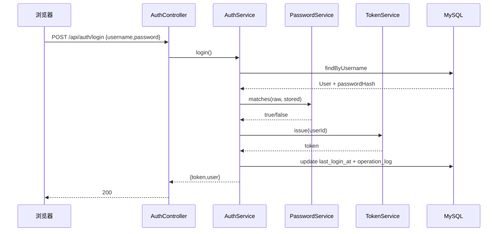
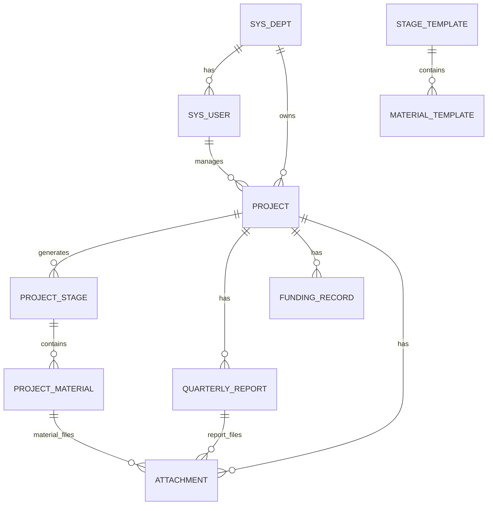
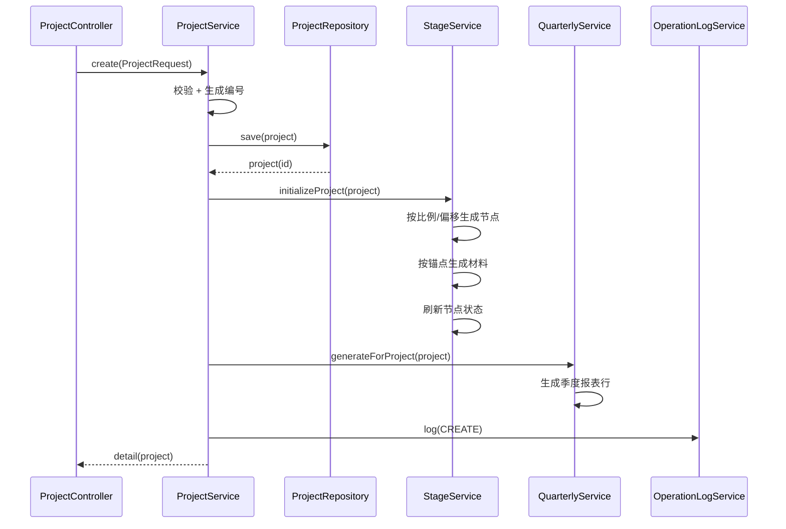
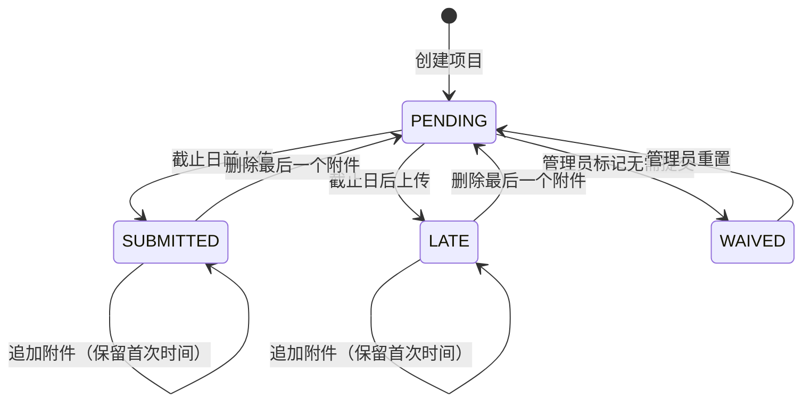
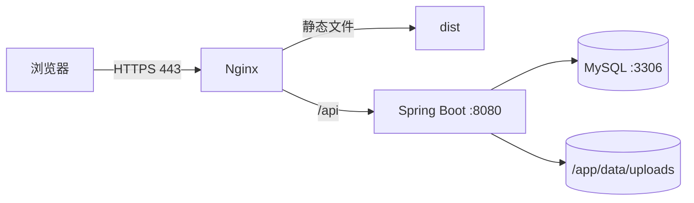

# 科研项目材料管理系统
# 技术设计说明书

| 项目 | 内容 |
| --- | --- |
| 文档版本 | V1.0 |
| 对应代码 | `research-material-system` |
| 架构 | B/S，前后端分离，模块化单体 |
| 后端 | Java 17 + Spring Boot 3.2.5 + Spring Data JPA + JdbcTemplate |
| 前端 | Vue 3.5 + Vite 6 + Element Plus + ECharts |
| 数据库 | MySQL 8.0+ |
| 部署 | Nginx + Spring Boot Jar；可选 Docker Compose |

## 1. 总体架构



### 1.1 架构选择

采用“模块化单体”而非微服务，原因：

- 使用规模为部门级，单库、单应用足以支撑。
- 材料、报表、经费、提醒之间存在强事务关联，单体更易保证一致性。
- 部署简单，适合国企内网一台虚拟机快速上线。
- 代码按领域分包，后续可平滑拆分。

### 1.2 技术选型

| 层次 | 技术 | 选择理由 |
| --- | --- | --- |
| 后端框架 | Spring Boot 3.2.5 | Java 17 生态成熟、社区资料多、易于国企运维接手 |
| 持久层 | Spring Data JPA + JdbcTemplate | 写操作使用实体，复杂列表/看板使用手写 SQL，兼顾效率与可读性 |
| 数据库 | MySQL 8.0 | 国企常见、运维成本低、支持窗口函数/CTE |
| 认证 | 自研 HMAC 签名 Token | 不引入 Spring Security 依赖，轻量、可读、易替换为 SSO |
| 密码 | PBKDF2-HMAC-SHA256 | JDK 原生支持，避免额外加密库 |
| 前端框架 | Vue 3 + Vite | 构建快、组合式 API、生态成熟 |
| UI | Element Plus | 后台系统组件齐全，适合快速二次开发 |
| 图表 | ECharts | 看板与大屏图表表现力强 |
| 反向代理 | Nginx | 静态资源、SPA 路由、上传大小、HTTPS 终止 |

> 未使用 Lombok，减少 IDE 插件和注解处理器依赖；实体使用显式 getter/setter，便于接手人员阅读和改造。

## 2. 代码结构

```text
backend/src/main/java/com/enterprise/research/
├─ ResearchMaterialApplication.java
├─ common/
│  ├─ ApiResponse.java              统一响应 {code,message,data}
│  ├─ PageResult.java               分页结构
│  ├─ BizException.java             业务异常（携带 HTTP 状态）
│  └─ GlobalExceptionHandler.java   全局异常处理
├─ config/
│  ├─ AppProperties.java            app.* 配置绑定
│  └─ WebConfig.java                CORS + 拦截器注册
├─ security/
│  ├─ AuthPrincipal.java            当前用户
│  ├─ AuthContext.java              ThreadLocal 上下文
│  ├─ AuthInterceptor.java          Bearer Token 校验
│  ├─ TokenService.java             HMAC-SHA256 签名/验签
│  ├─ PasswordService.java          PBKDF2 哈希
│  ├─ PermissionService.java        角色/项目级权限
│  └─ RoleCodes.java                角色常量
├─ entity/                          11 个 JPA 实体
├─ repository/                      Spring Data 仓储
├─ service/
│  ├─ AuthService / OperationLogService
│  ├─ ProjectService / ProjectQueryService
│  ├─ StageService / MaterialService
│  ├─ QuarterlyService / FundingService
│  ├─ AttachmentService
│  ├─ AlertService / DashboardService
│  ├─ CategoryQueryService
│  ├─ TemplateService / UserService
├─ controller/                      REST API
└─ init/DemoDataInitializer.java    本地演示数据
```

```text
frontend/src/
├─ api/http.js          axios 实例、Token、错误处理、Blob 下载
├─ api/index.js         按领域封装接口
├─ stores/auth.js       登录态、角色、项目级权限
├─ router/index.js      路由与角色守卫
├─ components/
│  ├─ AppLayout.vue     侧边栏、顶栏、提醒气泡、改密
│  ├─ ChartPanel.vue    ECharts 容器
│  └─ ProjectFormDialog.vue
├─ views/
│  ├─ LoginView.vue
│  ├─ DashboardView.vue
│  ├─ ProjectsView.vue
│  ├─ ProjectDetailView.vue
│  ├─ CategoryMaterialsView.vue   立项/采购/变更/检测/知识产权/验收分类台账
│  ├─ QuarterlyView.vue           全局季度执行台账
│  ├─ AlertsView.vue
│  ├─ TemplatesView.vue
│  ├─ UsersView.vue
│  ├─ DisplayView.vue
│  └─ NotFoundView.vue
├─ utils/format.js      状态字典、金额、日期、文件大小
└─ styles/index.css     设计系统与 Element Plus 覆盖
```

## 3. 认证与权限设计

### 3.1 登录时序



Token 结构：

```text
base64url(userId:expireEpochSecond) + "." + base64url(HMAC-SHA256(payload, AUTH_SECRET))
```

- 无状态，服务重启后仍有效（取决于密钥不变）。
- 默认 12 小时过期，`AUTH_EXPIRE_HOURS` 可调。
- 登出由前端清除本地 Token；服务端不维护会话黑名单。
- 修改密码后旧 Token 在过期前仍有效；若需立即失效，可在用户表增加 `token_version` 并写入 Token。

### 3.2 密码存储

```text
pbkdf2$120000$<base64 salt>$<base64 hash>
```

- 算法：PBKDF2WithHmacSHA256
- 迭代：120,000
- 盐：16 字节 SecureRandom
- 输出：256 bit
- 比对：`MessageDigest.isEqual` 常量时间比较

### 3.3 权限模型

采用轻量 RBAC + 项目级数据权限：

| 层 | 规则 |
| --- | --- |
| 路由级 | 前端根据角色隐藏菜单；后端仍然校验 |
| 接口级 | `AuthInterceptor` 校验登录；Service 校验角色 |
| 数据级 | `PermissionService.canManageProject(project)`：管理员/科研管理员全量；项目经理仅本人 |
| 范围 SQL | `PermissionService.scopeSql("p")` 自动附加 `p.manager_id = ?`，用于列表、提醒、看板 |

关键方法：

```java
boolean canManageProject(Project p) {
    if (isAdmin() || isResearchManager()) return true;
    return isProjectManager() && p.getManagerId().equals(current().id());
}
```

注意：Token 中不信任角色，拦截器每次从数据库加载用户，角色变更/停用即时生效。

### 3.4 安全边界

- 登录、健康检查、大屏接口不经过 Token 拦截器。
- 大屏接口使用 `DISPLAY_ACCESS_KEY` 查询参数，常量时间比较。
- 附件下载/预览需要项目可见权限。
- 上传文件名去除路径分隔符，存储路径规范化并校验 `startsWith(storageRoot)`。
- 上传文件大小由 Spring Multipart 与业务层双重限制。

## 4. 领域模型与关键流程

### 4.1 领域模型


详细字段见《数据库设计说明书》。

### 4.2 外部系统边界

本系统不复制现有业务系统的审批能力，只做材料归集和状态展示：

| 外部系统 | 本系统交互方式 | 关键字段/材料 |
| --- | --- | --- |
| 数智采购系统 | 线下完成采购申请后，归集采购申请及 ERP 流程材料 | `M-PROC-01` |
| ERP | 回填 ERP 立项编号、采购申请编号；项目主数据以 ERP 为准 | `project.erp_project_no`、`project.procurement_request_no` |
| 采购询比系统 | 归集调研公告、三家响应、调研评审、询价公告、三家报价、最低价确认材料；回填询比系统编号 | `project.inquiry_no`、`M-PROC-02`—`M-PROC-07` |
| 本系统 | 以项目为根，按材料分类汇总材料完成情况，输出台账、提醒和大屏 | `project_material.material_category` |

### 4.3 创建项目



设计要点：

- 节点与材料保存模板快照（名称、编码、比例、锚点、偏移），模板后续变化不影响历史项目。
- 季度报表从开始季度到结束季度生成，最多 120 行保护。
- 创建过程在一个事务内完成；任何一步失败回滚。

### 4.4 材料上传与节点自动完成



- 上传后：写附件记录 → 更新材料首次提交信息 → 刷新所属节点状态 → 操作日志。
- 追加附件：如果材料已有首次提交时间，不改变状态、提交时间和按时/逾期判定。
- 删除最后附件：材料回退为 `PENDING`，刷新节点状态。
- 节点刷新：必备材料全部为 `SUBMITTED/LATE/WAIVED` 时，节点 `COMPLETED`；否则根据计划日期置 `NOT_STARTED/IN_PROGRESS`。

### 4.5 季度报表

- 生成：项目创建、项目日期变更、手工“同步周期”时补齐缺失行；不删除历史行。
- 保存：`SAVE` 仅更新内容，状态保持 `PENDING`。
- 提交：校验本期执行情况非空，状态 `SUBMITTED`，记录提交人和时间。
- 撤回：仅管理员/科研管理员，状态回 `PENDING`，清空提交信息。
- 逾期判断：查询层用 `CASE WHEN submitted_at > due_date THEN 'LATE' ...`，不额外存冗余状态。

### 4.6 提醒计算

提醒不是定时任务，而是查询时计算：

```sql
-- 逾期材料
m.status = 'PENDING' AND m.due_date < CURDATE() AND m.required = 1

-- 逾期报表
q.status = 'PENDING' AND q.due_date < CURDATE()

-- 即将到期
due_date BETWEEN CURDATE() AND DATE_ADD(CURDATE(), INTERVAL :upcomingDays DAY)
```

优点：

- 不需要调度器、消息表、重复消费处理。
- 任何数据变更后立即反映。
- 多实例部署天然一致。

限制：

- 无法主动推送；如需邮件/企业微信，可新增 `AlertNotifyJob` 定时扫描并调用现有 `AlertService` 查询。

### 4.7 经费汇总

- 明细表 `funding_record` 是唯一事实来源。
- 每次新增/修改/删除后，`FundingService.recalculate(project)` 求和并回写 `project.budget_spent`。
- 回写字段用于列表/看板快速展示；如需强一致，可在事务内执行。
- 经费执行率 = `budget_spent / budget_total`；预算为 0 时返回 0，避免除零。

## 5. 接口设计

### 5.1 统一响应

```json
{
  "code": 0,
  "message": "ok",
  "data": {}
}
```

- `code=0` 表示成功；非 0 时 `message` 为中文提示。
- HTTP 状态码同时表达语义：400 参数、401 未登录、403 越权、404 不存在、409 冲突、413 文件过大、500 服务异常。
- 分页结构：

```json
{
  "items": [],
  "total": 120,
  "page": 1,
  "size": 10
}
```

### 5.2 路径约定

| 前缀 | 说明 |
| --- | --- |
| `/api/auth` | 登录、当前用户、改密 |
| `/api/projects` | 项目、节点 |
| `/api/materials` | 材料 |
| `/api/quarterly` | 季度报表（项目维度 + 全局台账） |
| `/api/categories/{category}/projects` | 分类材料台账（立项/采购/变更/检测/知识产权/验收） |
| `/api/attachments` | 附件下载/删除 |
| `/api/alerts` | 提醒 |
| `/api/dashboard` | 内部看板 |
| `/api/public` | 公开大屏（访问码） |
| `/api/templates` | 流程模板 |
| `/api/users` `/api/depts` `/api/logs` | 系统管理 |
| `/api/meta/options` | 字典与下拉选项 |

完整的接口清单见《API 接口清单》。

### 5.3 参数与日期

- 日期：`yyyy-MM-dd`。
- 时间：`yyyy-MM-dd HH:mm` 或 ISO `yyyy-MM-ddTHH:mm:ss`（Jackson 输出）。
- 金额：单位万元，`DECIMAL(14,2)`，JSON 数字。
- 布尔：`true/false`。

## 6. 数据库访问策略

采用“写实体、读 SQL”的混合模式：

- 写：JPA 实体 + Repository，自动管理主键、时间戳、事务。
- 读：`NamedParameterJdbcTemplate` 写明确 SQL，直接返回前端需要的字段，避免 N+1 和复杂 DTO 映射。
- 复杂统计：看板、提醒、项目列表、材料列表均使用 SQL 聚合/子查询。
- 索引：见数据库设计文档。

JPA 配置：

```yaml
spring:
  jpa:
    open-in-view: false
    hibernate:
      ddl-auto: none
```

- `ddl-auto=none`：表结构由 `db/schema.sql` 管理，避免生产误改表。
- `open-in-view=false`：避免懒加载在视图层产生隐式查询。

## 7. 前端设计

### 7.1 路由与角色

| 路由 | 页面 | 允许角色 |
| --- | --- | --- |
| `/login` | 登录 | 公开 |
| `/display` | 展示大屏 | 公开 + 访问码 |
| `/dashboard` | 运行总览 | 登录用户 |
| `/projects` | 项目台账 | 登录用户 |
| `/projects/:id` | 项目详情 | 登录用户（按数据权限） |
| `/initiation` | 立项管理 | 登录用户（按数据权限） |
| `/execution/quarterly` | 季度执行 | 登录用户（按数据权限） |
| `/execution/procurement` | 采购管理 | 登录用户（按数据权限） |
| `/execution/change` | 变更管理 | 登录用户（按数据权限） |
| `/execution/testing` | 检测报告 | 登录用户（按数据权限） |
| `/execution/ip` | 知识产权 | 登录用户（按数据权限） |
| `/acceptance` | 验收管理 | 登录用户（按数据权限） |
| `/alerts` | 逾期提醒 | 登录用户 |
| `/templates` | 流程模板 | ADMIN / RESEARCH_MANAGER |
| `/system` | 系统管理 | ADMIN |

前端路由守卫只做体验层控制，真正权限在后端再次校验。

### 7.2 状态管理

使用轻量 `reactive` store，不引入 Pinia/Vuex：

- `token`、`user` 持久化到 `localStorage`。
- 计算 `isAdmin`、`canManageAll`、`canWrite`、`canManageProject`。
- 登录成功写入，登出/401 清除。

### 7.3 请求与错误

- axios 统一加 `Authorization`。
- 业务 `code != 0` 转 Promise reject，并 `ElMessage.error`。
- 401 清除本地登录态并跳转 `/login?redirect=...`。
- Blob 请求（下载/预览）跳过统一 JSON 解析。
- 删除/提交等操作使用 Element Plus 确认框。

### 7.4 设计系统

- 主色：科研蓝 `#2563eb`，深海军蓝 `#071a33`，青色 `#0891b2`。
- 卡片圆角 16px，阴影轻量，背景 `#f3f6fb`。
- 大屏深色 `#041426`，青色高亮，网格背景，适配 16:9。
- 响应式断点：1200px、900px、780px。

### 7.5 大屏数据与布局

`DisplayView.vue` 使用 `/api/public/display` 的公开数据，按 16:9 驾驶舱布局：

```text
顶部 8 个统计卡
研发投入趋势（左，43%）
项目节点（左，剩余）
材料归集分布（右，38%）
项目验收结果（右，34%）
逾期与待办（右，剩余）
```

- `DashboardService.display()` 负责组装统计、月度经费趋势、材料分类、项目节点和逾期列表。
- `fundingTrend` 按当前年度从 `funding_record` 聚合，返回 12 个月的月度金额与累计金额。
- `categoryStats` 按 `project_material.material_category` 聚合总量和已归集数。
- `projects[].stages` 由 `DashboardService.attachStageProgress()` 二次查询项目节点并按 `projectId` 分组挂载。
- 验收状态由验收节点材料完成数推导：`已验收`、`可验收`、`材料未齐`、`未到验收`。

## 8. 配置设计

全部配置可通过环境变量覆盖：

| 环境变量 | 默认值 | 说明 |
| --- | --- | --- |
| `SERVER_PORT` | 8080 | 后端端口 |
| `DB_HOST` | 127.0.0.1 | MySQL 主机 |
| `DB_PORT` | 3306（local 3307） | MySQL 端口 |
| `DB_NAME` | research_material | 数据库名 |
| `DB_USERNAME` | root | 数据库用户 |
| `DB_PASSWORD` | 空 | 数据库密码 |
| `AUTH_SECRET` | 开发默认值 | Token 签名密钥，生产必须替换 |
| `AUTH_EXPIRE_HOURS` | 12 | Token 有效期 |
| `STORAGE_ROOT` | ./data/uploads | 附件根目录 |
| `DISPLAY_ACCESS_KEY` | research-display-2026 | 大屏访问码 |
| `QUARTERLY_DUE_DAYS` | 15 | 季度报表截止天数 |
| `ALERT_UPCOMING_DAYS` | 30 | 即将到期天数 |
| `CORS_ALLOWED_ORIGINS` | localhost:5173 等 | 跨域来源 |
| `DEMO_ENABLED` | false | 是否生成演示项目（local 默认 true） |
| `TOMCAT_BASEDIR` | ./data/tomcat | Tomcat 临时目录 |

## 9. 事务与一致性

| 场景 | 事务范围 | 说明 |
| --- | --- | --- |
| 创建项目 | 项目 + 节点 + 材料 + 季度报表 + 日志 | 同一事务，失败全部回滚 |
| 修改项目日期 | 项目 + 节点重算 + 待提交材料截止日 + 新增季度 | 已提交材料不改写 |
| 上传材料 | 附件 + 材料状态 + 节点状态 + 日志 | 文件先落盘，DB 失败删除文件 |
| 提交报表 | 报表内容 + 状态 + 日志 | 校验必填 |
| 经费新增/删除 | 明细 + 项目累计 + 日志 | 汇总回写 |
| 演示数据 | 全部演示数据 | `rollbackFor=Exception` |

文件与数据库无法共享事务，采用“先写文件、再写数据库，失败清理文件”的补偿策略。

## 10. 部署架构



- 开发：Vite 5173 代理 `/api` 到 8080。
- 生产：Nginx 托管 `frontend/dist`，`/api` 反向代理到后端。
- 可选 Docker Compose：MySQL + 后端 + 前端 Nginx 三个容器。
- 附件目录需持久化；数据库需定期备份。

## 11. 可观测性与运维

- Spring Boot 控制台日志 + 业务操作日志表。
- 健康检查：`GET /api/health`，可用于 Nginx/负载均衡探活。
- 数据库慢查询：建议开启 slow_query_log，重点关注看板聚合与提醒查询。
- 附件目录监控：容量、增长、备份。
- 建议日志保留 90 天，操作日志保留 2 年（按企业制度调整）。

## 12. 扩展点

### 12.1 接入统一身份认证

替换 `AuthService.login` 与 `AuthInterceptor`：

- 对接 OAuth2/OIDC：校验 ID Token，映射本地用户。
- 对接 LDAP：`LdapAuthenticationProvider` 或自定义 bind。
- 保留 `AuthPrincipal` 和 `PermissionService`，业务代码无需改动。

### 12.2 对象存储

`AttachmentService.store/download` 抽象为 `FileStorage` 接口：

- `LocalFileStorage`：当前实现。
- `MinioFileStorage`、`OssFileStorage`：替换实现即可。

### 12.3 消息通知

新增定时任务：

```text
每日 08:30 调用 AlertService.list("ALL", "OVERDUE") + UPCOMING
按项目经理聚合，发送企业微信/邮件
```

无需改动提醒查询逻辑。

### 12.4 材料打包导出

按项目聚合 `attachment.storage_path`，使用 ZIP 流式下载；可按节点生成目录结构。

### 12.5 多组织

在 `project`、`sys_user` 增加 `tenant_id`，所有查询通过 `PermissionService` 附加租户条件。

## 13. 已知限制与取舍

| 限制 | 原因 | 建议 |
| --- | --- | --- |
| 无审批流 | 需求明确只记录不审批 | 如后续需要，可接 Flowable/Camunda |
| Token 无服务端黑名单 | 轻量设计 | 如需强制下线，增加 token_version |
| 大屏访问码为共享密钥 | 内网低成本 | 增加 IP 白名单或展示账号登录 |
| 附件本地存储 | 部署简单 | 生产建议对象存储 + 备份 |
| 看板实时聚合 | 数据量小 | 数据量大时增加汇总表/缓存 |
| 无自动测试覆盖核心接口 | 首版交付 | 建议补充 Testcontainers 集成测试 |

## 14. 构建与验证

后端：

```powershell
cd backend
mvn -DskipTests package
java -jar target/research-material-backend.jar --spring.profiles.active=local
```

前端：

```powershell
cd frontend
pnpm install
pnpm build
pnpm dev
```

验证顺序：

1. `GET /api/health` 返回 UP。
2. 登录获取 Token。
3. `GET /api/dashboard` 返回指标。
4. 创建项目并检查节点/材料/季度报表。
5. 上传附件、下载附件。
6. 提交季度报表。
7. 登记经费并检查累计值。
8. 打开 `/display?key=...` 检查大屏。
