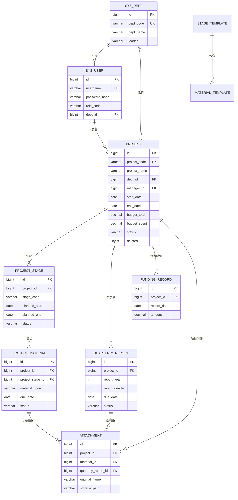

# 科研项目材料管理系统
# 数据库设计说明书

| 项目 | 内容 |
| --- | --- |
| 数据库 | MySQL 8.0+ |
| 数据库名 | `research_material` |
| 字符集 | `utf8mb4` / `utf8mb4_general_ci` |
| 时区 | Asia/Shanghai（+08:00） |
| 金额单位 | 万元 |
| 主键 | `BIGINT AUTO_INCREMENT` |
| 表数量 | 11 张业务表 |
| 初始化脚本 | `db/schema.sql`、`db/data.sql` |

## 1. 设计原则

1. **模板与实例分离**：`stage_template` / `material_template` 是配置；`project_stage` / `project_material` 是项目快照。模板调整不影响历史项目。
2. **事实表与汇总字段并存**：`funding_record` 是经费事实表，`project.budget_spent` 是汇总缓存，便于列表/看板快速展示。
3. **状态可扩展**：状态使用 `VARCHAR` 而非 MySQL `ENUM`，新增状态不需要改表。
4. **软删除**：项目、附件使用 `deleted` 逻辑删除；模板使用 `enabled=0` 停用。
5. **审计留痕**：`created_at`、`updated_at`、`submitted_at`、`submitted_by`、`uploaded_by` 等字段记录关键动作。
6. **外键约束**：核心关联建立外键，防止脏数据；项目删除时级联删除节点/材料/报表/经费/附件（当前使用逻辑删除，物理删除仅用于运维）。
7. **索引服务于查询**：项目状态/部门/经理、材料截止日/状态、报表截止日/状态、附件归属。

## 2. ER 图



## 3. 表清单

| 序号 | 表名 | 中文名 | 说明 |
| --- | --- | --- | --- |
| 1 | `sys_dept` | 部门 | 组织归属与部门统计 |
| 2 | `sys_user` | 用户 | 账号、角色、部门 |
| 3 | `project` | 科研项目 | 项目主数据 |
| 4 | `stage_template` | 流程节点模板 | 节点比例、偏移、顺序 |
| 5 | `material_template` | 材料模板 | 节点材料、必备、截止锚点 |
| 6 | `project_stage` | 项目节点实例 | 项目计划节点与状态 |
| 7 | `project_material` | 项目材料实例 | 截止日期、状态、提交信息 |
| 8 | `quarterly_report` | 季度执行报表 | 按季度填报 |
| 9 | `funding_record` | 经费台账 | 支出明细 |
| 10 | `attachment` | 附件 | 材料/报表/项目附件 |
| 11 | `operation_log` | 操作日志 | 审计留痕 |

## 4. 表结构

### 4.1 `sys_dept` 部门

| 字段 | 类型 | 空 | 默认 | 键/约束 | 说明 |
| --- | --- | --- | --- | --- | --- |
| `id` | BIGINT | 否 | 自增 | PK | 主键 |
| `dept_code` | VARCHAR(30) | 否 | — | UK | 部门编码 |
| `dept_name` | VARCHAR(100) | 否 | — | — | 部门名称 |
| `leader` | VARCHAR(50) | 是 | NULL | — | 部门负责人 |
| `sort_no` | INT | 否 | 0 | — | 排序 |
| `status` | TINYINT | 否 | 1 | — | 1 启用 / 0 停用 |
| `created_at` | DATETIME | 否 | CURRENT_TIMESTAMP | — | 创建时间 |
| `updated_at` | DATETIME | 否 | CURRENT_TIMESTAMP | — | 更新时间 |

### 4.2 `sys_user` 用户

| 字段 | 类型 | 空 | 默认 | 键/约束 | 说明 |
| --- | --- | --- | --- | --- | --- |
| `id` | BIGINT | 否 | 自增 | PK | 主键 |
| `username` | VARCHAR(50) | 否 | — | UK | 登录账号 |
| `password_hash` | VARCHAR(255) | 否 | — | — | PBKDF2 摘要 |
| `real_name` | VARCHAR(50) | 否 | — | — | 姓名 |
| `role_code` | VARCHAR(30) | 否 | — | IDX | ADMIN/RESEARCH_MANAGER/PROJECT_MANAGER/VIEWER |
| `dept_id` | BIGINT | 是 | NULL | FK→sys_dept | 所属部门 |
| `phone` | VARCHAR(30) | 是 | NULL | — | 手机号 |
| `email` | VARCHAR(100) | 是 | NULL | — | 邮箱 |
| `status` | TINYINT | 否 | 1 | — | 1 启用 / 0 停用 |
| `last_login_at` | DATETIME | 是 | NULL | — | 最近登录 |
| `created_at` | DATETIME | 否 | CURRENT_TIMESTAMP | — | 创建时间 |
| `updated_at` | DATETIME | 否 | CURRENT_TIMESTAMP | — | 更新时间 |

索引：`uk_username`、`idx_user_dept`、`idx_user_role`。

### 4.3 `project` 科研项目

| 字段 | 类型 | 空 | 默认 | 键/约束 | 说明 |
| --- | --- | --- | --- | --- | --- |
| `id` | BIGINT | 否 | 自增 | PK | 主键 |
| `project_code` | VARCHAR(60) | 否 | — | UK | 项目编号（内部） |
| `erp_project_no` | VARCHAR(60) | 是 | NULL | — | ERP 立项编号 |
| `procurement_request_no` | VARCHAR(60) | 是 | NULL | — | ERP 采购申请编号 |
| `inquiry_no` | VARCHAR(60) | 是 | NULL | — | 采购询比系统编号 |
| `project_name` | VARCHAR(200) | 否 | — | — | 项目名称 |
| `category` | VARCHAR(30) | 否 | 纵向 | — | 纵向/横向/内部 |
| `project_level` | VARCHAR(30) | 是 | NULL | — | 国家级/省部级/集团级/院级 |
| `project_source` | VARCHAR(100) | 是 | NULL | — | 项目来源 |
| `dept_id` | BIGINT | 否 | — | FK→sys_dept | 承担部门 |
| `manager_id` | BIGINT | 否 | — | FK→sys_user | 项目经理 |
| `participants` | VARCHAR(500) | 是 | NULL | — | 参与人员 |
| `start_date` | DATE | 否 | — | — | 计划开始 |
| `end_date` | DATE | 否 | — | IDX | 计划结束 |
| `budget_total` | DECIMAL(14,2) | 否 | 0.00 | — | 批复经费（万元） |
| `budget_spent` | DECIMAL(14,2) | 否 | 0.00 | — | 累计支出（万元，汇总缓存） |
| `funding_source` | VARCHAR(100) | 是 | NULL | — | 经费来源 |
| `status` | VARCHAR(30) | 否 | ACTIVE | IDX | 项目状态 |
| `progress` | INT | 否 | 0 | — | 形象进度 0-100 |
| `description` | TEXT | 是 | NULL | — | 项目简介 |
| `deleted` | TINYINT | 否 | 0 | — | 逻辑删除 |
| `created_by` | BIGINT | 是 | NULL | — | 创建人 |
| `created_at` | DATETIME | 否 | CURRENT_TIMESTAMP | — | 创建时间 |
| `updated_at` | DATETIME | 否 | CURRENT_TIMESTAMP | — | 更新时间 |

索引：`uk_project_code`、`idx_project_dept`、`idx_project_manager`、`idx_project_status`、`idx_project_end`。

项目状态取值：`PLANNING`、`ACTIVE`、`MID_TERM`、`FINAL`、`COMPLETED`、`TERMINATED`。

### 4.4 `stage_template` 流程节点模板

| 字段 | 类型 | 空 | 默认 | 说明 |
| --- | --- | --- | --- | --- |
| `id` | BIGINT | 否 | 自增 | PK |
| `stage_code` | VARCHAR(40) | 否 | — | UK，节点编码 |
| `stage_name` | VARCHAR(100) | 否 | — | 节点名称 |
| `seq_no` | INT | 否 | 0 | 展示顺序 |
| `start_ratio` | DECIMAL(5,4) | 否 | 0.0000 | 项目周期开始比例 |
| `end_ratio` | DECIMAL(5,4) | 否 | 1.0000 | 项目周期结束比例 |
| `start_offset_days` | INT | 否 | 0 | 开始日期偏移天数 |
| `end_offset_days` | INT | 否 | 0 | 结束日期偏移天数 |
| `description` | VARCHAR(500) | 是 | NULL | 说明 |
| `enabled` | TINYINT | 否 | 1 | 是否启用 |
| `created_at`/`updated_at` | DATETIME | 否 | CURRENT_TIMESTAMP | 时间戳 |

### 4.5 `material_template` 材料模板

| 字段 | 类型 | 空 | 默认 | 说明 |
| --- | --- | --- | --- | --- |
| `id` | BIGINT | 否 | 自增 | PK |
| `template_code` | VARCHAR(50) | 否 | — | UK，材料编码 |
| `stage_id` | BIGINT | 否 | — | FK→stage_template |
| `material_category` | VARCHAR(30) | 否 | OTHER | 业务分类，IDX |
| `material_name` | VARCHAR(150) | 否 | — | 材料名称 |
| `required` | TINYINT | 否 | 1 | 是否必备 |
| `due_anchor` | VARCHAR(20) | 否 | STAGE_END | 截止锚点 |
| `due_offset_days` | INT | 否 | 0 | 相对锚点偏移 |
| `allow_late` | TINYINT | 否 | 1 | 是否允许逾期补传 |
| `description` | VARCHAR(500) | 是 | NULL | 说明 |
| `sort_no` | INT | 否 | 0 | 排序 |
| `enabled` | TINYINT | 否 | 1 | 是否启用 |
| `created_at`/`updated_at` | DATETIME | 否 | CURRENT_TIMESTAMP | 时间戳 |

`due_anchor` 取值：`PROJECT_START`、`PROJECT_END`、`STAGE_START`、`STAGE_END`。

### 4.6 `project_stage` 项目节点实例

| 字段 | 类型 | 空 | 默认 | 说明 |
| --- | --- | --- | --- | --- |
| `id` | BIGINT | 否 | 自增 | PK |
| `project_id` | BIGINT | 否 | — | FK→project，级联删除 |
| `stage_template_id` | BIGINT | 是 | NULL | FK→stage_template，SET NULL |
| `stage_code` | VARCHAR(40) | 否 | — | 节点编码快照 |
| `stage_name` | VARCHAR(100) | 否 | — | 节点名称快照 |
| `seq_no` | INT | 否 | 0 | 顺序快照 |
| `start_ratio` | DECIMAL(5,4) | 否 | 0.0000 | 比例快照 |
| `end_ratio` | DECIMAL(5,4) | 否 | 1.0000 | 比例快照 |
| `planned_start` | DATE | 是 | NULL | 计划开始 |
| `planned_end` | DATE | 是 | NULL | 计划结束 |
| `actual_start` | DATE | 是 | NULL | 实际开始 |
| `actual_end` | DATE | 是 | NULL | 实际完成 |
| `status` | VARCHAR(20) | 否 | NOT_STARTED | 节点状态 |
| `entered_at` | DATETIME | 是 | NULL | 首次进入节点时间 |
| `remark` | VARCHAR(500) | 是 | NULL | 备注 |
| `created_at`/`updated_at` | DATETIME | 否 | CURRENT_TIMESTAMP | 时间戳 |

唯一键：`uk_project_stage(project_id, stage_code)`；索引：`idx_stage_project`。

### 4.7 `project_material` 项目材料实例

| 字段 | 类型 | 空 | 默认 | 说明 |
| --- | --- | --- | --- | --- |
| `id` | BIGINT | 否 | 自增 | PK |
| `project_id` | BIGINT | 否 | — | FK→project，级联删除 |
| `project_stage_id` | BIGINT | 否 | — | FK→project_stage，级联删除 |
| `material_template_id` | BIGINT | 是 | NULL | FK→material_template，SET NULL |
| `material_category` | VARCHAR(30) | 否 | OTHER | — | 业务分类快照 |
| `material_code` | VARCHAR(50) | 否 | — | 材料编码快照 |
| `material_name` | VARCHAR(150) | 否 | — | 材料名称快照 |
| `required` | TINYINT | 否 | 1 | 是否必备 |
| `due_anchor` | VARCHAR(20) | 否 | STAGE_END | 锚点快照 |
| `due_offset_days` | INT | 否 | 0 | 偏移快照 |
| `allow_late` | TINYINT | 否 | 1 | 是否允许逾期补传快照 |
| `due_date` | DATE | 是 | NULL | 截止日期 |
| `status` | VARCHAR(20) | 否 | PENDING | 材料状态 |
| `submitted_at` | DATETIME | 是 | NULL | 首次提交时间 |
| `submitted_by` | BIGINT | 是 | NULL | 首次提交人 |
| `late_reason` | VARCHAR(500) | 是 | NULL | 逾期补传说明/无需提交原因 |
| `note` | VARCHAR(1000) | 是 | NULL | 备注 |
| `sort_no` | INT | 否 | 0 | 排序 |
| `created_at`/`updated_at` | DATETIME | 否 | CURRENT_TIMESTAMP | 时间戳 |

唯一键：`uk_project_material(project_id, material_code)`；索引：`idx_material_project`、`idx_material_stage`、`idx_material_category(project_id,material_category)`、`idx_material_due(due_date,status)`。

材料状态：`PENDING`、`SUBMITTED`、`LATE`、`WAIVED`。

### 4.8 `quarterly_report` 季度执行报表

| 字段 | 类型 | 空 | 默认 | 说明 |
| --- | --- | --- | --- | --- |
| `id` | BIGINT | 否 | 自增 | PK |
| `project_id` | BIGINT | 否 | — | FK→project，级联删除 |
| `report_year` | INT | 否 | — | 年份 |
| `report_quarter` | INT | 否 | — | 1—4 |
| `period_start` | DATE | 否 | — | 季度开始 |
| `period_end` | DATE | 否 | — | 季度结束 |
| `due_date` | DATE | 否 | — | 截止日期 |
| `status` | VARCHAR(20) | 否 | PENDING | PENDING/SUBMITTED |
| `summary` | TEXT | 是 | NULL | 本期执行情况 |
| `achievements` | TEXT | 是 | NULL | 阶段成果 |
| `issues` | TEXT | 是 | NULL | 存在问题 |
| `next_plan` | TEXT | 是 | NULL | 下期计划 |
| `budget_spent_period` | DECIMAL(14,2) | 否 | 0.00 | 本期支出 |
| `budget_spent_cumulative` | DECIMAL(14,2) | 否 | 0.00 | 累计支出（自报） |
| `submitted_at` | DATETIME | 是 | NULL | 提交时间 |
| `submitted_by` | BIGINT | 是 | NULL | 提交人 |
| `created_at`/`updated_at` | DATETIME | 否 | CURRENT_TIMESTAMP | 时间戳 |

唯一键：`uk_report_period(project_id, report_year, report_quarter)`；索引：`idx_report_due(due_date,status)`。

说明：`overdue` 不落库，由 `due_date < CURDATE()` 且 `status='PENDING'` 计算；`LATE` 由 `submitted_at > due_date` 计算。

### 4.9 `funding_record` 经费台账

| 字段 | 类型 | 空 | 默认 | 说明 |
| --- | --- | --- | --- | --- |
| `id` | BIGINT | 否 | 自增 | PK |
| `project_id` | BIGINT | 否 | — | FK→project，级联删除 |
| `record_date` | DATE | 否 | — | 发生/入账日期 |
| `amount` | DECIMAL(14,2) | 否 | — | 金额（万元），支出为正数 |
| `funding_type` | VARCHAR(30) | 否 | 自筹 | 财政拨款/自筹/其他 |
| `cost_category` | VARCHAR(50) | 是 | NULL | 支出科目 |
| `description` | VARCHAR(500) | 是 | NULL | 说明 |
| `created_by` | BIGINT | 是 | NULL | 登记人 |
| `created_at` | DATETIME | 否 | CURRENT_TIMESTAMP | 登记时间 |

索引：`idx_funding_project`。

### 4.10 `attachment` 附件

| 字段 | 类型 | 空 | 默认 | 说明 |
| --- | --- | --- | --- | --- |
| `id` | BIGINT | 否 | 自增 | PK |
| `project_id` | BIGINT | 否 | — | FK→project，级联删除 |
| `material_id` | BIGINT | 是 | NULL | FK→project_material，级联删除 |
| `quarterly_report_id` | BIGINT | 是 | NULL | FK→quarterly_report，级联删除 |
| `biz_scope` | VARCHAR(20) | 否 | MATERIAL | MATERIAL/QUARTERLY/PROJECT |
| `original_name` | VARCHAR(255) | 否 | — | 原始文件名 |
| `stored_name` | VARCHAR(255) | 否 | — | 存储文件名 |
| `storage_path` | VARCHAR(500) | 否 | — | 相对存储根路径 |
| `content_type` | VARCHAR(150) | 是 | NULL | MIME |
| `file_size` | BIGINT | 否 | 0 | 字节数 |
| `sha256` | VARCHAR(64) | 是 | NULL | 文件摘要 |
| `uploaded_by` | BIGINT | 是 | NULL | 上传人 |
| `uploaded_at` | DATETIME | 否 | CURRENT_TIMESTAMP | 上传时间 |
| `deleted` | TINYINT | 否 | 0 | 逻辑删除 |

索引：`idx_attach_project`、`idx_attach_material`、`idx_attach_report`。

### 4.11 `operation_log` 操作日志

| 字段 | 类型 | 空 | 默认 | 说明 |
| --- | --- | --- | --- | --- |
| `id` | BIGINT | 否 | 自增 | PK |
| `user_id` | BIGINT | 是 | NULL | 操作人 ID |
| `username` | VARCHAR(50) | 是 | NULL | 操作人账号快照 |
| `role_code` | VARCHAR(30) | 是 | NULL | 角色快照 |
| `module` | VARCHAR(50) | 否 | — | 模块 |
| `action` | VARCHAR(50) | 否 | — | 动作 |
| `target_type` | VARCHAR(50) | 是 | NULL | 对象类型 |
| `target_id` | BIGINT | 是 | NULL | 对象 ID |
| `detail` | VARCHAR(1000) | 是 | NULL | 详情 |
| `ip` | VARCHAR(64) | 是 | NULL | 客户端 IP |
| `created_at` | DATETIME | 否 | CURRENT_TIMESTAMP | 时间 |

索引：`idx_log_created`、`idx_log_user`。

## 5. 索引设计说明

| 索引 | 服务查询 |
| --- | --- |
| `uk_project_code` | 项目编号唯一校验 |
| `idx_project_status` | 状态筛选、看板状态分布 |
| `idx_project_dept` | 部门统计、部门筛选 |
| `idx_project_manager` | 项目经理数据范围 |
| `idx_material_due(due_date,status)` | 逾期/即将到期材料扫描 |
| `idx_material_category(project_id,material_category)` | 立项/采购/变更/检测/知识产权/验收分类台账 |
| `idx_material_project` | 项目详情材料列表 |
| `idx_report_due(due_date,status)` | 逾期/即将到期报表扫描 |
| `uk_report_period` | 季度唯一性、按周期查询 |
| `idx_attach_material` | 材料附件列表 |
| `idx_log_created` | 日志按时间倒序分页 |

## 6. 关键数据规则

1. **项目编号**唯一；逻辑删除后可重新使用，但建议不复用。
2. **项目起止日期**：`end_date >= start_date`，由后端校验。
3. **节点唯一性**：同一项目同一 `stage_code` 唯一。
4. **材料唯一性**：同一项目同一 `material_code` 唯一。
5. **季度唯一性**：同一项目同一年同一季度唯一。
6. **金额**：`DECIMAL(14,2)`，单位万元；支出金额 > 0。
7. **附件路径**：相对路径，禁止 `..`；下载时二次校验。
8. **逻辑删除**：项目 `deleted=1` 后列表/统计排除；附件 `deleted=1` 后不计入。
9. **时间戳**：应用服务器统一 Asia/Shanghai；数据库连接串设置 `serverTimezone=Asia/Shanghai`。
10. **模板快照**：项目创建后节点/材料名称、编码、锚点、偏移不再随模板变化。
11. **业务分类快照**：`project_material.material_category` 在项目创建时从模板复制，用于立项/采购/变更/检测/知识产权/验收/归档分类台账。
12. **外部系统编号**：`erp_project_no`、`procurement_request_no`、`inquiry_no` 仅作为外部系统关联，不强制唯一；由项目经理或科研管理员手工回填。

## 7. 初始化数据

`db/data.sql` 包含：

- 3 个部门（数智研发中心、技术研发部、科技管理部）。
- 5 个账号（admin、zhangwei、dengjianping、chenchao、screen）。
- 4 个流程节点模板。
- 20 个材料模板（10 个必备 + 10 个选交），覆盖附件1—9、采购询比材料、检测报告、知识产权和归档材料。
- 默认密码使用 PBKDF2，首次部署后请修改。

演示项目由 `DemoDataInitializer` 在 `app.demo.enabled=true` 且项目表为空时生成，包括：

- 4 个项目（含 2 个已完成、2 个在研/结题）。
- 80 条项目材料、28 份季度报表、48 个附件、经费记录。
- 用于展示逾期提醒、材料补传、报表填报和大屏效果。

生产环境设置 `DEMO_ENABLED=false`，并执行 `db/data.sql` 后可手工创建项目。

## 8. 备份与恢复

```powershell
# 备份
mysqldump --host=127.0.0.1 --port=3306 --user=root --password `
  --single-transaction --routines --triggers research_material > backup.sql

# 恢复
mysql --host=127.0.0.1 --port=3306 --user=root --password research_material < backup.sql
```

注意：

- 附件目录需与数据库一起备份，否则会丢失文件。
- 建议每日全量备份数据库 + 附件增量备份，保留 30 天。
- 大版本升级前先在测试库执行增量脚本。

## 9. 数据量评估

按 500 个项目、每项目 20 条材料、20 个季度、10 条经费、30 个附件估算：

| 表 | 预估行数 |
| --- | --- |
| project | 500 |
| project_stage | 3,000 |
| project_material | 8,000 |
| quarterly_report | 10,000 |
| funding_record | 5,000 |
| attachment | 15,000 |
| operation_log | 100,000+ |

MySQL 单实例完全可支撑；看板聚合查询在 1 秒内可完成。超过 5,000 个项目时建议增加汇总表或缓存。
