# 科研项目材料管理系统
# 用户操作手册

适用角色：系统管理员、科研管理员、项目经理、查看/展示账号。

## 1. 登录与退出

打开系统地址，进入登录页。

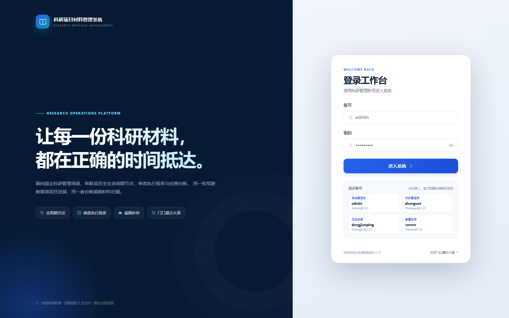

1. 输入账号和密码。
2. 点击“进入系统”。
3. 首次登录后，点击右上角姓名 → “修改密码”，修改初始密码。
4. 退出：右上角姓名 → “退出登录”。

演示账号可点击登录页下方卡片自动填入。生产环境请删除或停用演示账号。

## 2. 角色与能看到什么

| 角色 | 能看到 | 能做什么 |
| --- | --- | --- |
| 系统管理员 | 全部菜单、全部项目 | 所有操作，含用户/部门/模板/日志 |
| 科研管理员 | 除系统管理外的全部菜单 | 全部项目、模板、日志、催报、补传 |
| 项目经理 | 运行总览、项目管理、逾期提醒 | 本人项目维护、材料上传、季度填报、经费登记 |
| 查看/展示 | 运行总览、项目管理、逾期提醒 | 只读查看 |

菜单会按角色自动隐藏；直接访问越权接口会被后端拒绝。

## 3. 运行总览

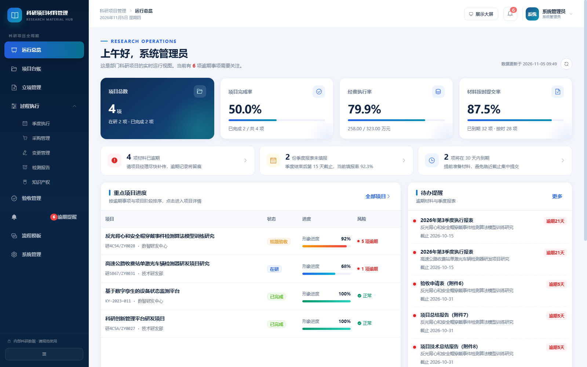

页面包含：

- **项目总数**：未删除项目数量，并显示在研/已完成数量。
- **项目完成率**：已完成项目 / 项目总数。
- **经费执行率**：累计支出 / 批复经费。
- **材料按时提交率**：已到期必备材料中按时提交的比例。
- **逾期提醒条**：逾期材料、逾期季度报表、30 天内到期。
- **重点项目进度**：按逾期风险和结题时间排序，点击行进入项目详情。
- **待办提醒**：逾期材料/报表，点击可直接跳到处理位置。
- **项目状态分布**：环形图。
- **部门项目与经费**：柱状图。

右上角“展示大屏”会在新窗口打开 `/display`。

## 4. 项目台账

### 4.1 查看与筛选

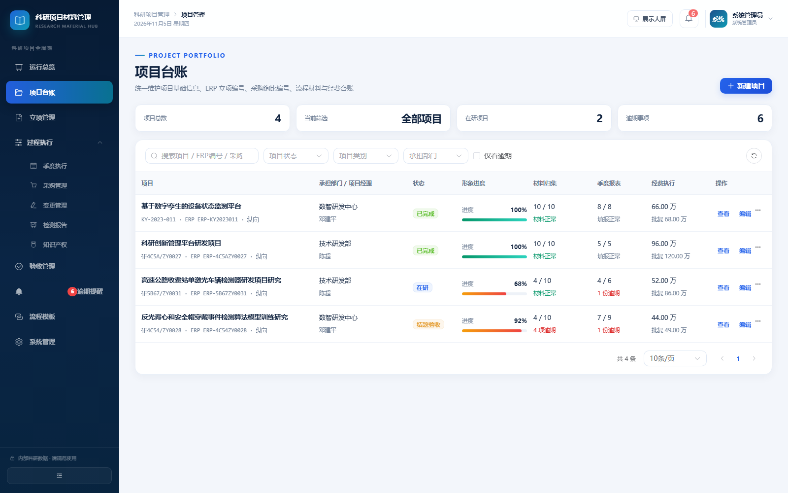

支持按项目名称/编号/负责人搜索，按状态、类别、部门筛选，勾选“仅看逾期”。

列表字段：

- 项目名称、编号、类别、级别、部门、项目经理。
- 项目状态、形象进度。
- 材料归集：已交/应备，逾期数量。
- 季度报表：已填/总期数，逾期数量。
- 经费：累计支出/批复经费。

点击项目行进入详情。

### 4.2 新建项目

1. 点击右上角“新建项目”。
2. 填写项目名称、类别、级别、承担部门、项目经理、起止日期、批复经费、状态、进度，以及 ERP 立项编号、采购申请编号、询比系统编号等。
3. 项目编号可留空，系统自动生成 `KY-年份-序号`。
4. 点击“创建项目”。

创建成功后，系统自动：

- 生成 4 个流程节点：立项准备、执行过程、验收管理、成果归档。
- 生成 10 项必备材料和 10 项选交材料，覆盖附件1—9、采购询比、检测、知识产权和归档。
- 生成从开始季度到结束季度的季度报表行。
- 按项目周期比例计算节点计划日期和材料截止日期。

### 4.3 编辑与删除

- 有权限的用户可在列表或详情点击“编辑”。
- 项目经理只能编辑本人项目，且不能把项目转交他人。
- 删除为逻辑删除，历史数据保留；列表不再显示。
- 修改项目起止日期会重算未提交材料截止日期，并补充新增季度。

### 4.4 外部系统编号

项目表单新增三个字段：

- **ERP 立项编号**：ERP 立项流程完成后的项目编号。
- **ERP 采购申请编号**：采购申请通过后的编号。
- **采购询比系统编号**：询比系统项目/询价单编号。

这些编号会显示在项目台账、立项管理、采购管理和项目详情中，作为与现有系统的关联依据。

## 5. 立项管理

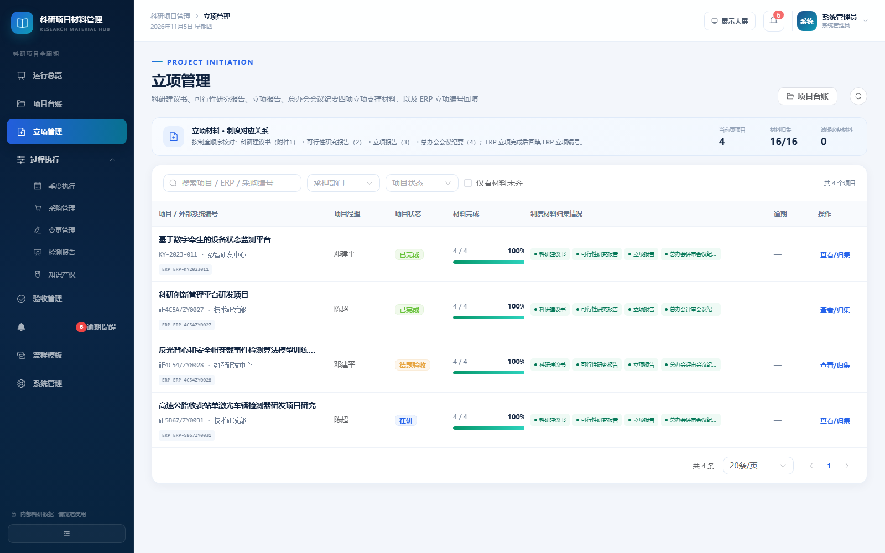

对应制度附件1—附件4：

| 材料 | 制度附件 |
| --- | --- |
| 科研建议书 | 附件1 |
| 可行性研究报告 | 附件2 |
| 立项报告 | 附件3 |
| 总办会评审会议纪要 | 附件4 |

页面会显示每个项目的四项材料完成情况、ERP 立项编号和逾期必备材料数量。点击材料节点可直接进入项目详情上传；未回填 ERP 编号的项目会显示“ERP立项编号待回填”。

立项流程：

1. 项目经理上传附件1—附件3。
2. 总办会评审后上传附件4会议纪要。
3. ERP 立项流程完成后，在项目台账中回填 ERP 立项编号。
4. 进入“过程执行”。

## 6. 过程执行

“过程执行”是二级菜单，包含季度执行、采购管理、变更管理、检测报告、知识产权五个页面。

### 6.1 季度执行

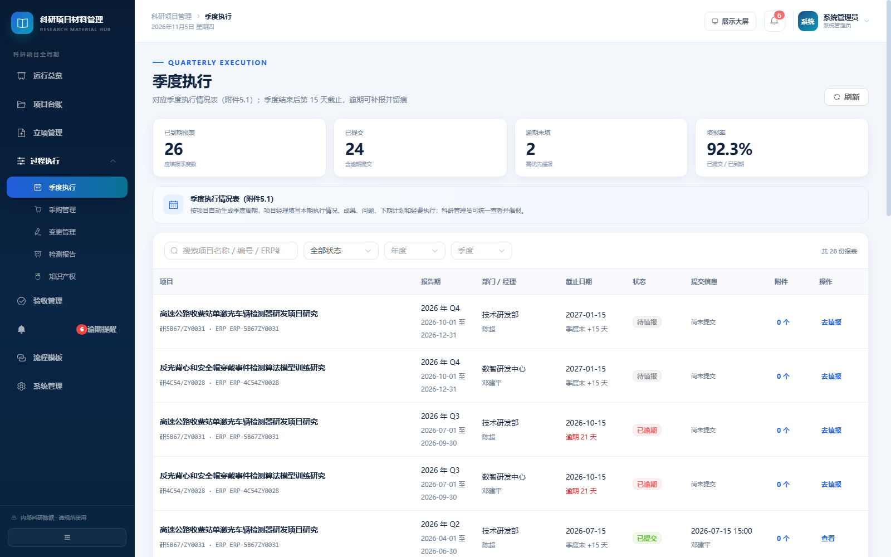

对应季度执行情况表（附件5.1）。

- 全局查看所有项目的季度报表，支持按状态、年度、季度、项目关键字筛选。
- 报表自动生成，季度末 +15 天截止。
- 点击“去填报”进入项目详情的季度报表窗口。
- 逾期未填显示“已逾期”；逾期后补报显示“逾期提交”。

### 6.2 采购管理

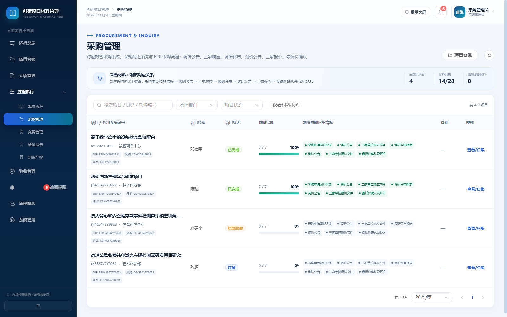

对应采购询比全链路，共 7 个材料节点：

1. 采购申请及 ERP 流程材料（5.2-1）
2. 调研公告（5.2-2）
3. 三家单位响应文件（5.2-3）
4. 调研评审报表（5.2-4）
5. 询价公告（5.2-5）
6. 三家单位报价文件（5.2-6）
7. 最低价确认及 ERP 录入材料（5.2-7）

页面显示每个项目的材料完成数和流程节点状态。采购相关材料为选交材料，不纳入逾期必备材料统计；如项目发生采购，应逐项归集。

### 6.3 变更管理

对应项目变更情况表（附件5.3）。项目发生变更时，将变更情况表、变更依据等上传到该分类；未发生变更的项目可以保持未归集，不纳入逾期统计。

### 6.4 检测报告

对应检测报告（附件5.4）。同一材料支持上传多份检测报告。

### 6.5 知识产权

对应知识产权证明（附件5.5），归集软著、专利、论文等成果证明。

## 7. 验收管理

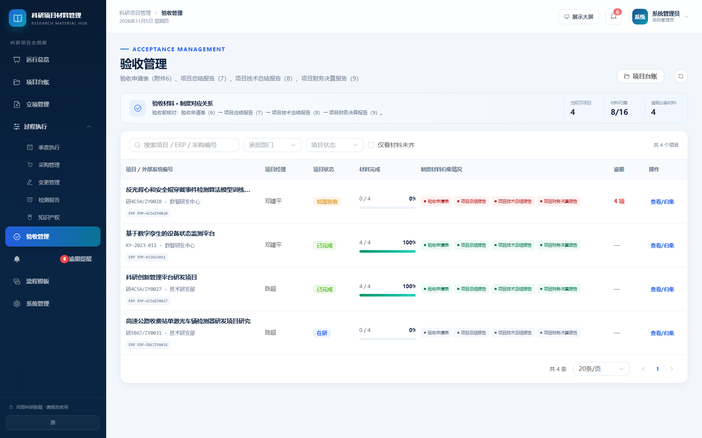

对应验收材料：

| 材料 | 制度附件 |
| --- | --- |
| 验收申请表 | 附件6 |
| 项目总结报告 | 附件7 |
| 项目技术总结报告 | 附件8 |
| 项目财务决算报告 | 附件9 |

验收前应确保四项材料齐备。验收管理页面显示每个项目的材料完成情况、逾期数量和节点状态，点击“查看/归集”进入项目详情。

## 8. 项目详情

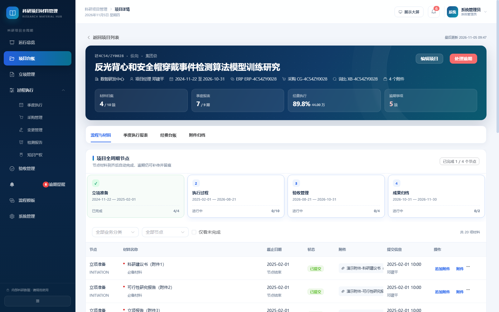

顶部展示项目编号、名称、部门、经理、周期、附件数、材料归集、季度报表、经费执行、逾期事项。

### 8.1 流程与材料

- 横向节点卡展示节点计划起止、状态、材料完成数。
- 节点卡颜色：
  - 绿色：已完成。
  - 蓝色：进行中。
  - 灰色：未开始。
- 材料表格支持按节点筛选、仅看未完成。
- 状态说明：
  - 已提交：截止日前上传。
  - 已逾期：超过截止日期仍未上传。
  - 逾期提交：超过截止日期后补传。
  - 无需提交：科研管理员标记。

### 8.2 上传材料

1. 找到材料行，点击“上传材料”/“逾期补传”/“追加附件”。
2. 拖入或选择文件。
3. 若已逾期，填写“补传说明”（选填，建议填写）。
4. 点击“确认上传”。

规则：

- 单文件默认不超过 50MB。
- 同一材料可上传多个附件。
- 追加附件不改变首次提交时间和按时/逾期判定。
- 删除最后一个附件后，材料会回到“待提交”。

### 8.3 查看/下载/删除附件

- 点击材料行的附件文件名，打开附件列表。
- “下载”保存到本地。
- PDF/图片/文本支持“预览”。
- 有权限用户可删除附件。

### 8.4 标记无需提交

科研管理员/系统管理员：

1. 材料行右侧“...” → “标记无需提交”。
2. 填写原因，确认。

适用场景：该项目确实不涉及某类材料。标记后计入节点完成，但保留原因。

### 8.5 季度执行报表

1. 切换到“季度执行报表”标签。
2. 找到对应季度，点击“填报”。
3. 填写本期执行情况、阶段成果、存在问题、下期计划、本期支出、累计支出。
4. “保存草稿”可稍后继续；“提交报表”后不可直接修改。
5. 已逾期仍可提交，系统标记“逾期提交”。
6. 科研管理员可“撤回重填”。

报表附件：

- 在列表行点击“N 个”打开附件列表。
- 可上传、下载、删除报表附件。

### 8.6 经费台账

1. 切换到“经费台账”。
2. 查看批复经费、累计支出、预算余额、执行率。
3. 点击“登记支出”，填写日期、金额、类型、科目、说明。
4. 保存后累计支出自动更新。
5. 可编辑/删除明细。

金额单位为万元。发生日期不能晚于今天。

### 8.7 附件归档

“附件归档”标签汇总项目下所有材料附件和报表附件，支持下载、预览、删除。

## 9. 逾期与到期提醒

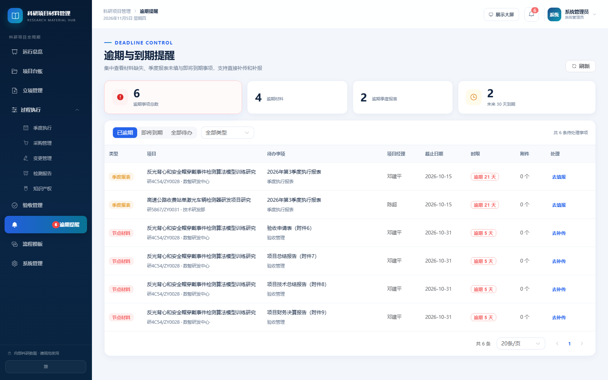

页面顶部汇总：

- 逾期事项总数。
- 逾期材料数。
- 逾期季度报表数。
- 未来 30 天到期数。

筛选：

- 已逾期 / 即将到期 / 全部待办。
- 全部类型 / 节点材料 / 季度报表。

处理：

- 材料：点击“去补传”，跳转项目详情并自动打开上传窗口。
- 报表：点击“去填报”，跳转项目详情并自动打开报表填报窗口。

> 项目经理只看到本人项目的提醒。

## 10. 流程模板

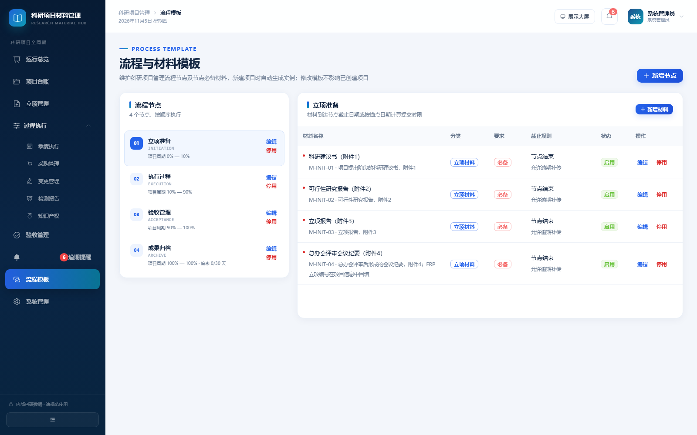

仅系统管理员/科研管理员可见。

### 10.1 节点模板

- 左侧为节点列表，点击查看该节点材料。
- “新增节点”：填写编码、名称、顺序、周期比例、偏移天数。
- “编辑”：修改节点信息。
- “停用”：新建项目不再生成该节点，历史项目不受影响。

周期比例示例：`0.45—0.55` 表示项目周期的 45% 到 55%。

### 10.2 材料模板

- “新增材料”：填写编码、名称、业务分类、是否必备、截止锚点、偏移天数、是否允许逾期补传。
- 业务分类决定材料进入哪个台账页面：立项、采购、变更、检测、知识产权、验收、归档或其他。
- 截止锚点：
  - 节点结束日期（默认）。
  - 节点开始日期。
  - 项目结束日期。
  - 项目开始日期。
- “停用”：新建项目不再生成该材料。

> 模板修改不会回写已创建项目，保证历史材料名称、截止日期稳定。

## 11. 系统管理

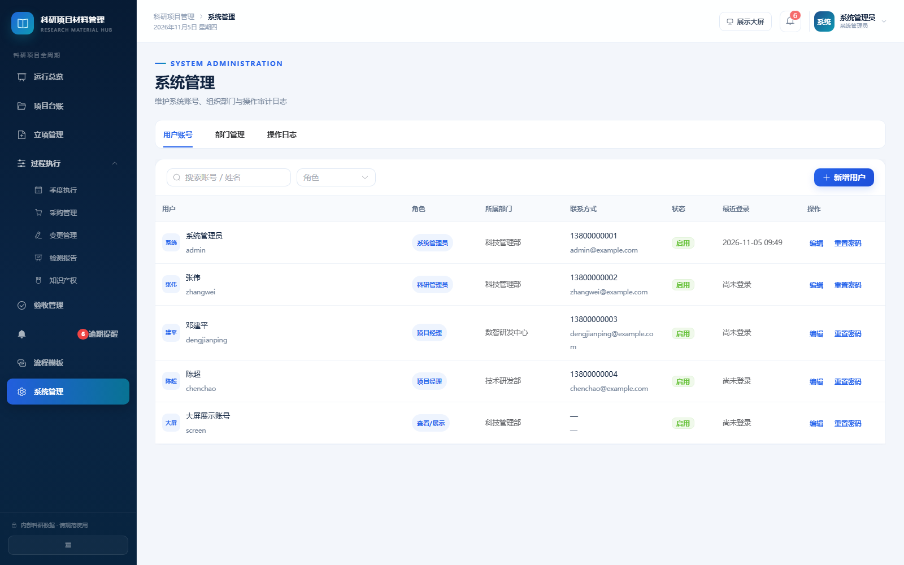

仅系统管理员可见。

### 11.1 用户账号

- 搜索账号/姓名，按角色筛选。
- 新增用户：账号、姓名、角色、部门、联系方式、初始密码。
- 编辑用户：可改姓名、角色、部门、联系方式、状态；账号不可改。
- 重置密码：为指定用户设置新密码。
- 停用账号：停用后无法登录。

### 11.2 部门管理

- 新增/编辑部门编码、名称、负责人、排序、状态。
- 部门用于项目归属和看板统计。

### 11.3 操作日志

按时间倒序展示：

- 时间、操作人、模块、动作、操作内容、IP。

用于追溯项目创建、修改、材料上传、报表提交、经费变更、用户/模板维护等操作。

## 12. 门口展示大屏

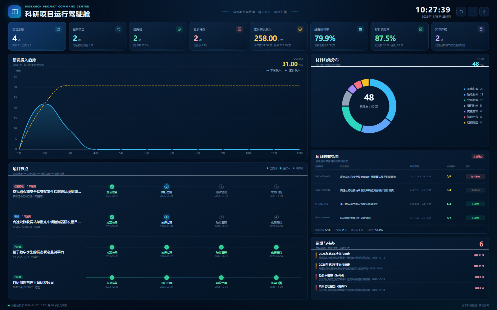

访问地址：

```text
http://系统地址/display?key=展示访问码
```

首次访问：

1. 输入展示访问码。
2. 点击“进入驾驶舱”。
3. 点击右上角全屏按钮或按 F11。
4. 系统每 60 秒自动刷新。

大屏采用“顶部统计卡 + 研发投入趋势 + 材料归集分布 + 项目节点 + 验收结果 + 逾期待办”的驾驶舱布局：

- **顶部 8 个统计卡**：项目总数、在研项目、已完成、验收待办、累计研发投入、经费执行率、材料按时率、知识产权归集项目。
- **研发投入趋势**：按当前年度展示每月研发投入和累计投入，右上角显示全年累计金额。
- **材料归集分布**：按立项、采购、变更、检测、知识产权、验收、归档分类展示材料项数量，中心显示已归集/总量。
- **项目节点**：按项目展示四个阶段（立项准备、执行过程、验收管理、成果归档）的计划完成日期和状态。
- **项目验收结果**：展示项目编号、名称、周期、验收材料完成数和验收状态（已验收/可验收/材料未齐/未到验收）。
- **逾期与待办**：展示逾期材料和季度报表，按逾期天数排序。
- 当前时间、数据更新时间、60 秒自动刷新。

右上角按钮：

- 刷新：立即拉取最新数据。
- 全屏：进入/退出全屏。
- 钥匙：切换访问码。

安全提示：大屏数据可能包含项目名称和经费，请仅在授权内网展示。

## 13. 常见操作问答

**Q1：材料晚交了还能上传吗？**

可以。系统默认允许逾期补传，上传后会标记“逾期提交”并记录补传说明。若模板设置为不允许，则需联系科研管理员。

**Q2：为什么节点已经完成，但项目状态还是“在研”？**

节点完成是材料层面的自动判断；项目状态由管理人员按实际情况维护。二者相互独立。

**Q3：季度报表超过了截止日期还能填吗？**

可以。提交后会标记“逾期提交”，并在提醒/列表中体现。

**Q4：为什么项目经理看不到某个项目？**

项目经理默认只能看到本人负责的项目。需要科研管理员在项目上把经理改为该用户。

**Q5：为什么删除附件后材料变成“待提交”？**

材料以附件是否存在作为提交依据。删除最后一个附件后，系统回退状态，需重新上传。

**Q6：大屏显示“访问码不正确”？**

联系管理员确认 `DISPLAY_ACCESS_KEY`，或在地址后使用正确的 `?key=...`。

**Q7：项目编号可以修改吗？**

可以，但必须全局唯一。已经在外部文件中引用的编号修改后需同步更新。

**Q8：如何导出项目材料？**

当前版本提供附件逐个下载；按项目打包导出可作为后续扩展（见技术设计扩展点）。
